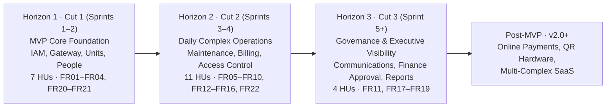

# Product Roadmap — resi-complex

> **Document Status:** Complete (Synchronized with `03-product/vision.md`, `04-requirements/fr-to-service-mapping.md`, and live GitHub repositories)  
> **Last Updated:** 2026-11-21

---

## 1. Horizon Overview

---

## 2. Detailed Delivery Cuts

### Cut 1 — Horizon 1: MVP Core Foundation (Sprints 1–2)
**Goal:** Establish secure authentication, centralized API routing, physical unit inventory (residential + commercial), and person/occupancy lifecycle so every downstream operational module has reliable identities, unit types, and ownership guards.

| Workstream | Service (`Port`) | FRs | HUs | Owner | Current Status |
|------------|------------------|-----|-----|-------|----------------|
| Centralized Edge & JWT Verification | `api-gateway` (`:8080` / local `:8090`) | Cross-cutting (`ADR-006`) | — | Fabián Trujillo | 🟡 Phase 1 Repo Live (4/4 tests passing) |
| Identity, RBAC (5 roles) & Staff Activation | `iam-service` (`:8081`) | `FR01`, `FR20` | `HU-IAM-001`, `HU-IAM-002` | Fabián Trujillo | 🟡 Phase 1 Repo Live (3/3 tests, Flyway + Hexagonal) |
| Units & 1:1 Commercial Establishments | `units-service` (`:8083`) | `FR02`, `FR03`, `FR04` | `HU-UNIT-001`, `HU-UNIT-002`, `HU-UNIT-003` | María Alexandra Garzón | 🔴 Repo initialized; OpenAPI & docs complete, code pending |
| People & Unit Occupancy Lifecycle | `people-service` (`:8085`) | `FR21` | `HU-PPL-001`, `HU-PPL-002` | María Alexandra Garzón | 🔴 OpenAPI & docs complete; implementation pending |

**Exit Gate (Cut 1):** End-to-end login through `api-gateway`, JWT propagation (`X-User-Id`, `X-User-Roles`, `X-User-Permissions`), CRUD of residential/commercial units, and active/inactive occupancy enforcement.

---

### Cut 2 — Horizon 2: Daily Complex Operations (Sprints 3–4)
**Goal:** Deliver the daily workflows used by Administrators, Residents/Merchants, Maintenance Staff, and Security Guards — replacing Excel fee sheets, WhatsApp repair chats, and paper gatehouse logbooks.

| Workstream | Service (`Port`) | FRs | HUs | Owner | Current Status |
|------------|------------------|-----|-----|-------|----------------|
| Maintenance Request Lifecycle & Verification | `maintenance-service` (`:8086`) | `FR05`, `FR06` | `HU-MAINT-001`, `HU-MAINT-002` | María Alexandra Garzón | 🔴 OpenAPI & docs complete; implementation pending |
| Reactive In-App Maintenance Notifications | `communications-service` (`:8082`) | `FR07` | `HU-MAINT-003` | Julián Losada | 🟡 Phase 1 Repo Live |
| Differentiated Monthly Fees & Partial Payments | `billing-service` (`:8084`) | `FR08`, `FR09`, `FR10` | `HU-BILL-001`, `HU-BILL-002` | Félix Murcia | 🟡 Phase 1 Repo Live |
| Visitor/Vehicle Access, Correspondence & Pre-Authorizations | `access-control-service` (`:8087`) | `FR12`–`FR16`, `FR22` | `HU-ACC-001`–`HU-ACC-006` | Julián Losada | 🟡 Phase 1 Repo Live |

**Exit Gate (Cut 2):** Automated monthly differentiated fee runs (`RESIDENTIAL` vs. `COMMERCIAL`), end-to-end maintenance request flow with `WORK_COMPLETED` verification, visitor/vehicle/correspondence PIN handover, and RabbitMQ + Transactional Outbox delivery (`ADR-005`).

---

### Cut 3 — Horizon 3: Governance & Executive Visibility (Sprint 5+)
**Goal:** Close the institutional transparency loop for the Administrator and Board of Trustees with segmented announcements, immutable quorum-based expense voting, and CQRS executive reports.

| Workstream | Service (`Port`) | FRs | HUs | Owner | Current Status |
|------------|------------------|-----|-----|-------|----------------|
| Segmented Announcements & Emergency Broadcasts | `communications-service` (`:8082`) | `FR11` | `HU-COMM-001` | Julián Losada | 🟡 Phase 1 Repo Live |
| Extraordinary Expense Proposals & Board Quorum Voting | `finance-approval-service` (`:8088`) | `FR17`, `FR18` | `HU-FIN-001`, `HU-FIN-002` | Félix Murcia | 🟡 Phase 1 Repo Live |
| CQRS Executive Reports (Arrears & Maintenance KPIs) | `reports-service` (`:8089`) | `FR19` | `HU-REP-001` | Félix Murcia | 🟡 Phase 1 Repo Live |
| Responsive Frontend Integration & Quality Certification | Web UI (`12-ux-ui/`) + CI Gates | `NFR-001`–`NFR-009` | All 22 HUs | Full Team | 🟡 Stitch UI Kit & 5 core mockups complete; integration pending |

**Exit Gate (Cut 3 / MVP Release v1.0.0):** 100% of `FR01–FR22` passing BDD acceptance tests, ≥ 80% JaCoCo coverage (`≥ 90%` domain), 0 ArchUnit violations (`NFR-006`), WCAG 2.1 AA validation (`NFR-009`), and k6 load test verifying `P95 < 300ms` (`NFR-001`).

---

## 3. Post-MVP Evolution Candidates (Out of Scope for v1.0)

Tracked explicitly in `01-context/scope.md` and `05-architecture/overview.md` §9 to prevent scope creep:

| Candidate Release | Feature Line | Architectural Impact |
|-------------------|--------------|----------------------|
| **v2.0** | Online Payment Gateway (PSE / Stripe / PayU) | New secondary adapter in `billing-service`; domain state machine unchanged |
| **v2.0** | QR-Code / Camera Pre-Authorization Scanning | Mobile scanning UI consuming `access-control-service` `visitor_preauthorizations` |
| **v2.0** | Common-Area Reservations | New Bounded Context (`amenities-service`) |
| **v3.0** | Multi-Complex SaaS & External Email/WhatsApp Notifications | Tenant scoping across services + external notification adapter in `communications-service` |

---

## 4. Correlations

- Product vision & OKRs → `03-product/vision.md`
- Detailed prioritized backlog → `03-product/product-backlog.md`
- FR-to-service dependency order → `04-requirements/fr-to-service-mapping.md`
- Live traceability status → `04-requirements/traceability-matrix.md`
