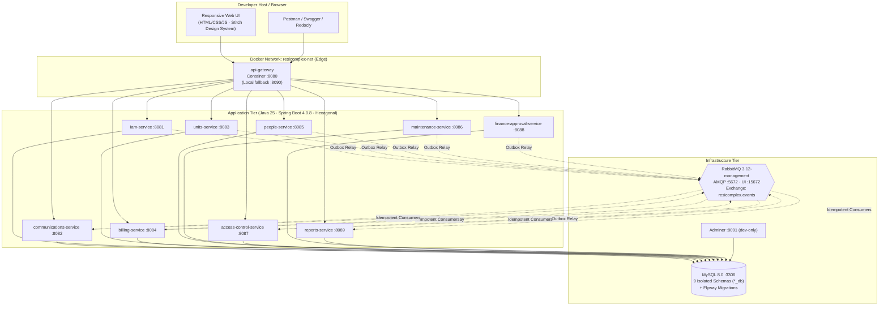

# Deployment Architecture — resi-complex

> **Document Status:** Complete (Resolves `AT-003` for Local MVP & defines Staging/Production evolution path)  
> **Aligned with:** `ADR-003`, `ADR-004`, `ADR-005`, `ADR-006`, `NFR-002`, `NFR-007`, `10-devops/`  
> **Last Updated:** 2026-11-21

---

## 1. Environment Strategy

| Environment | Orchestration | Purpose | Status |
|-------------|---------------|---------|--------|
| **Local (MVP)** | Docker Compose (`docker-compose.yml`) | Full-stack developer execution & SENA milestone demos | ✅ Active |
| **Development (CI)** | GitHub Actions + Testcontainers (`mysql:8.0`, `rabbitmq:3.12`) | Automated build, JaCoCo ≥ 80%, ArchUnit, OpenAPI lint | 🟡 Rolling out |
| **Staging / Production** | Kubernetes (managed cluster / OCI containers, GitOps) | Post-formative pilot complex rollout with Zero-Downtime Rolling/Blue-Green deploys | 🔴 Post-formative roadmap |

---

## 2. Local Container Topology (Docker Compose)

All containers run inside an isolated bridge network (`resicomplex-net`). Only the **API Gateway** and local operational dashboards (RabbitMQ UI, Adminer) publish host ports for browser access during development.

---

## 3. Canonical Port & Database Allocation

| Container / Service | Internal Port | Local Dev Port | Database Schema | Health Endpoint |
|---------------------|---------------|----------------|-----------------|-----------------|
| `api-gateway` | `8080` | `8080` *(or `8090` if `:8080` busy on Windows)* | None (stateless) | `GET /health` |
| `iam-service` | `8081` | `8081` | `iam_db` | `GET /health` |
| `communications-service` | `8082` | `8082` | `communications_db` | `GET /health` |
| `units-service` | `8083` | `8083` | `units_db` | `GET /health` |
| `billing-service` | `8084` | `8084` | `billing_db` | `GET /health` |
| `people-service` | `8085` | `8085` | `people_db` | `GET /health` |
| `maintenance-service` | `8086` | `8086` | `maintenance_db` | `GET /health` |
| `access-control-service` | `8087` | `8087` | `access_control_db` | `GET /health` |
| `finance-approval-service` | `8088` | `8088` | `finance_approval_db` *(alias `finance_db`)* | `GET /health` |
| `reports-service` | `8089` | `8089` | `reports_db` | `GET /health` |
| `mysql` (`mysql:8.0`) | `3306` | `3306` | 9 logical schemas | `mysqladmin ping` |
| `rabbitmq` (`rabbitmq:3.12-management`) | `5672` / `15672` | `5672` / `15672` | — | `rabbitmq-diagnostics ping` |
| `adminer` (dev profile) | `8080` | `8091` | UI for MySQL | `GET /` |

---

## 4. Container & 12-Factor Packaging Standards (`NFR-007`)

Every microservice repository adheres to the following containerization contract:
1. **Multi-Stage `Dockerfile`:** Builder stage (`maven:3.9-eclipse-temurin-25` or JDK 25) compiles the shaded JAR; runtime stage uses a minimal non-root JRE image (`eclipse-temurin:25-jre-alpine` / distroless).
2. **Strict Externalized Configuration:** Zero secrets or hardcoded URLs inside `application.properties`; all environment-specific settings injected via env vars (`SERVER_PORT`, `DB_URL`, `DB_USERNAME`, `DB_PASSWORD`, `JWT_SECRET`, `RABBITMQ_HOST`, `RABBITMQ_PORT`).
3. **Fail-Fast Schema Validation:** Every service runs **Flyway** (`spring.flyway.enabled=true`) on startup and enforces **`spring.jpa.hibernate.ddl-auto=validate`** so misaligned schemas fail immediately at boot.
4. **Probes & Graceful Shutdown:** `server.shutdown=graceful` with `GET /health` (liveness) and `GET /health/ready` (readiness verifying MySQL & RabbitMQ connectivity).

---

## 5. Production Evolution Path (Post-MVP)

When transitioning from the SENA formative local scope to a live residential complex pilot:
- **Container Orchestration:** Kubernetes Deployment + HorizontalPodAutoscaler (`minReplicas: 2`, `maxReplicas: 3` per `NFR-003`) with zero-downtime Rolling Updates (`maxUnavailable: 0`).
- **Database Isolation:** Managed MySQL 8 instance(s) with automated daily encrypted backups + binary-log point-in-time recovery (`RPO = 0`, `RTO < 5 min` per `NFR-008`), Expand-and-Contract Flyway migrations (`06-data/models.md`), and per-service IAM/DB credentials stored in a Secrets Manager / Vault.
- **Network Security:** TLS 1.3 termination at Ingress/API Gateway; internal microservice ports (`8081–8089`) unreachable from the public internet; internal mTLS via service mesh or signed service tokens.

---

## 6. Correlations

- Architecture Overview & ADRs → `05-architecture/overview.md`, `05-architecture/decisions/`
- Local Setup Runbook & Env Vars → `10-devops/local-setup.md`, `10-devops/environments.md`
- Database Schemas & Flyway Rules → `06-data/models.md`
- Service Runbooks → `09-microservices/services/*/runbook.md`
