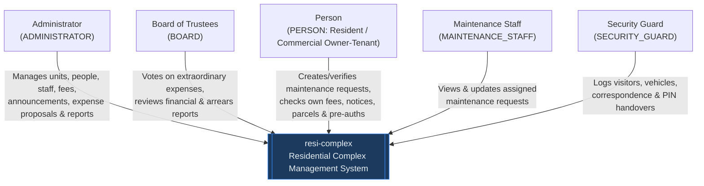
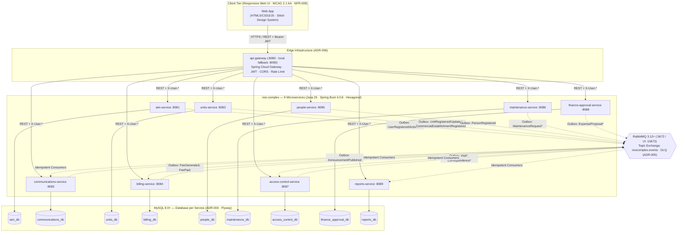

# System Architecture Overview — resi-complex

> This document is the technical snapshot of `resi-complex`'s architecture. It translates the
> **9 Bounded Contexts** identified in `02-domain/domain-map.md` into **9 deployable microservices**
> behind a central **API Gateway**, backed by **9 dedicated MySQL 8 databases** and **RabbitMQ** for
> asynchronous domain events. It guides every service specification in `09-microservices/`.

---

## 1. Adopted Architectural Style

**Style:** **Microservices + Event-Driven Architecture**, organized 1:1 around the 9 Bounded Contexts of `02-domain/domain-map.md`, each internally structured with **Hexagonal Architecture (Ports & Adapters)** (`hexagonal-architecture.md`), fronted by **Spring Cloud Gateway (`:8080`)** and connected asynchronously via **RabbitMQ 3.12+ + Transactional Outbox**.

**Justification:**
- **1:1 Domain Alignment:** Directly mirrors the 9 Bounded Contexts in `02-domain/domain-map.md`, preventing cross-domain leakage.
- **Native Event-Driven Execution:** Runs the 16 domain events and 6 reactive policies specified in `02-domain/domain-events.md` over RabbitMQ (`resicomplex.events`) with guaranteed at-least-once delivery (`outbox` + `processed_events`).
- **Confirmed Stack Fit:** Aligns with **Java 25 + Spring Boot 4.0.8** (Java 17+ / Spring Boot 3.x+ baseline) and **MySQL 8.0+** (`01-context/scope.md`, `_stacks/java-spring.md`).
- **Strategic Core Investment:** Enables deep domain testing on Core Domains (**Billing** and **Units Management**) independently from Generic Domains (**IAM** and **Reports**).

**Reference ADRs:**
- [`ADR-003`](decisions/records/ADR-003-architectural-style.md) — Microservices + Event-Driven Architectural Style
- [`ADR-004`](decisions/records/ADR-004-database-per-service.md) — Database per Service Pattern (MySQL 8.0+)
- [`ADR-005`](decisions/records/ADR-005-message-broker-selection.md) — Message Broker Selection (RabbitMQ) & Transactional Outbox
- [`ADR-006`](decisions/records/ADR-006-jwt-authentication-strategy.md) — JWT Authentication & API Gateway Strategy

---

## 2. C4 Diagram — System Context (Level 1)

> Shows how `resi-complex` fits in the world. Per `01-context/scope.md`, the MVP has **no external
> third-party integrations** (no payment gateway, no SMS/SMTP/WhatsApp provider) — the only external
> actors are the **5 canonical authentication roles** (`00-governance/security-policy.md`).

---

## 3. C4 Diagram — Container Topology (Level 2)

> Reflects all accepted infrastructure decisions (`ADR-003`–`ADR-006`) and reconciled canonical ports (`:8080`, `:8081`–`:8089`).

---

## 4. Canonical Service Catalog & Port Allocation

> Reconciled single source of truth across `05-architecture/`, `06-data/models.md`, `07-api/contracts/openapi/`, `09-microservices/service-catalog.md`, `10-devops/local-setup.md`, and live GitHub repositories under `https://github.com/resi-complex`.

| # | Canonical Service | Alias (OpenAPI / Folder) | Responsibility & FRs | Canonical Port | MySQL 8 DB | Communication |
|---|-------------------|--------------------------|----------------------|----------------|------------|---------------|
| 01 | `api-gateway` | `01-api-gateway` / `api-gateway.yaml` | Single edge entry point: JWT verification, `X-User-*` header propagation, CORS, rate limiting (`ADR-006`) | `8080` *(local `:8090`)* | None (stateless) | Sync REST edge proxy to `:8081–:8089` |
| 02 | `iam-service` | `02-auth-service` / `auth-service.yaml` | Authentication (5 roles), 1h JWT + 7d refresh rotation, staff provisioning & activation (`FR01`, `FR20`) — **Generic** | `8081` | `iam_db` | REST + Outbox (`UserRegistered`, `UserActivated`) |
| 03 | `communications-service` | `08-communications-service` / `communications-service.yaml` | Segmented announcements (`ALL`, `RESIDENTIAL_ONLY`, `COMMERCIAL_ONLY`) & reactive in-app notifications (`FR07`, `FR11`) — **Supporting** | `8082` | `communications_db` | REST + Consumes operational events; publishes `AnnouncementPublished` |
| 04 | `units-service` | `03-units-service` / `units-service.yaml` | Physical residential/commercial units & 1:1 commercial establishments (`FR02`–`FR04`) — **Core Domain** | `8083` | `units_db` | REST + Sync debt check to `billing-service`; publishes `Unit*`, `CommercialEstablishmentRegistered` |
| 05 | `billing-service` | `06-billing-service` / `billing-service.yaml` | Monthly differentiated administration fees, partial payments & arrears (`FR08`–`FR10`) — **Core Domain** | `8084` | `billing_db` | REST + Consumes `UnitRegistered/Updated`; publishes `FeeGenerated`, `FeePaid` |
| 06 | `people-service` | `04-people-service` / `people-service.yaml` | Resident/Merchant profiles & `unit_occupancies` tenancy lifecycle (`FR21`) — **Supporting** | `8085` | `people_db` | REST + Publishes `PersonRegistered` |
| 07 | `maintenance-service` | `05-maintenance-service` / `maintenance-service.yaml` | Maintenance request lifecycle with `WORK_COMPLETED` verification loop (`FR05`–`FR06`) — **Supporting** | `8086` | `maintenance_db` | REST + Publishes `MaintenanceRequestCreated`, `MaintenanceRequestStatusUpdated` |
| 08 | `access-control-service` | `09-access-control-service` / `access-control-service.yaml` | Visitor/vehicle entry-exit, visitor pre-authorizations & 4-digit PIN correspondence (`FR12`–`FR16`, `FR22`) — **Supporting** | `8087` | `access_control_db` | REST + Consumes `UnitRegistered`; publishes `Visit*`, `Correspondence*` |
| 09 | `finance-approval-service` | `07-finance-service` / `finance-service.yaml` | Extraordinary expense proposals & append-only Board quorum voting (`FR17`–`FR18`) — **Supporting** | `8088` | `finance_approval_db` *(alias `finance_db`)* | REST + Publishes `ExpenseProposalCreated/Approved/Rejected` |
| 10 | `reports-service` | `10-reports-service` / `reports-service.yaml` | CQRS read-only projections: maintenance breakdown & fee arrears (`FR19`) — **Generic** | `8089` | `reports_db` | Async event consumer + REST read endpoints (`reports:read`) |

Full per-service technical specifications, data models, events, decisions, and runbooks live in `09-microservices/service-catalog.md` and `09-microservices/services/01-*` through `10-*`.

---

## 5. Architectural Principles

### P1: API-First (Contract-First)
Design and lint the OpenAPI 3.0.3 contract (`07-api/contracts/openapi/`, validated via `npx @redocly/cli lint`) before implementing endpoints. Contracts are the formal promise between frontend, gateway, and backend services.

### P2: Database per Service (`ADR-004`)
Each of the 9 microservices owns its dedicated MySQL 8 database with Flyway migrations and `ddl-auto=validate`. Zero cross-database SQL joins; cross-service references are strictly logical `CHAR(36)` UUIDs.

### P3: Fail Fast, Recover Gracefully
Validate inputs at controller edges (`@Valid`) and enforce domain invariants inside Aggregates (`02-domain/entities-and-rules.md`). Protect synchronous inter-service calls with timeouts, retries with exponential backoff, and Resilience4j Circuit Breakers (`cross-cutting.md`).

### P4: Observability by Design (`NFR-005`)
Structured JSON logs with `X-Correlation-Id`, Spring Actuator + Prometheus RED metrics, and OpenTelemetry distributed tracing across all 10 containers (`cross-cutting.md`, `13-operations/observability.md`).

### P5: Ownership-Level Authorization by Default (`ADR-006`)
Every endpoint scoped to a Person or Unit enforces **ownership-level authorization** (`:own` / `:assigned` suffixes in `00-governance/security-policy.md`) inside the **Application / Use Case layer**, verifying `unit_occupancies.status = 'ACTIVE'` or `assigned_to == X-User-Id`.

---

## 6. Adopted Architectural Patterns

| Pattern | Adopted | Justification / Reference |
|---------|---------|---------------------------|
| **API Gateway** | **Yes** (`ADR-006`) | Spring Cloud Gateway (`:8080` / local `:8090`), centralized JWT, CORS & rate limiting |
| **Database per Service** | **Yes** (`ADR-004`) | 9 isolated MySQL 8 databases (`*_db`) managed via Flyway |
| **Hexagonal Architecture** | **Yes** (`hexagonal-architecture.md`) | Pure Java domain core verified by ArchUnit (`NFR-006`) |
| **Transactional Outbox + Idempotent Consumers** | **Yes** (`ADR-005`, `06-data/models.md`) | `outbox` + `processed_events` tables guarantee at-least-once, duplicate-safe RabbitMQ delivery |
| **CQRS (Read Projections)** | **Yes (scoped to `reports-service`)** | Event-built `requests_by_status_view` & `pending_fees_view` in `reports_db` |
| **Circuit Breaker & Retries** | **Adopted (Resilience4j)** | Protects sync calls (`units` → `billing`) and broker relays (`cross-cutting.md`) |
| **Event Sourcing** | **No** | Append-only audit table (`approvals`) satisfies governance needs without ES complexity |
| **Choreographed Saga** | **Not needed in MVP** | Cross-context reactions are unidirectional policies (`domain-events.md`), not multi-step compensations |

---

## 7. Cross-Cutting Concerns Summary

Detailed specifications live in [`05-architecture/cross-cutting.md`](./cross-cutting.md) and [`05-architecture/security-threat-model.md`](./security-threat-model.md):

| Concern | Adopted Solution | Status |
|---------|------------------|--------|
| Authentication / RBAC | `iam-service` (`:8081`) + `api-gateway` (`:8080`/`:8090`), 5 canonical roles, 1h JWT + 7d rotatable BCrypt refresh token (`ADR-006`) | 🟡 Implemented in Phase 1 repos |
| Ownership Authorization | `:own` / `:assigned` enforced in Application Use Cases (Principle `P5`) | 🟡 Active across service specs & repos |
| Error Format | Unified RFC 7807 `ErrorResponse` in `07-api/contracts/openapi/_shared.yaml` | ✅ Defined & referenced in all 10 OpenAPI contracts |
| Logging & Tracing | Structured JSON + `X-Correlation-Id` + OpenTelemetry / Prometheus (`NFR-005`) | 🟡 Standard defined in `cross-cutting.md` |
| Health Checks | `GET /health` + `GET /health/ready` (`NFR-002`) | 🟡 Live in 7/10 Phase 1 repos |
| Rate Limiting & CORS | Centralized at `api-gateway` (`240 RPM` default) | 🟡 Implemented in `resi-complex-api-gateway` |

---

## 8. Architectural Technical Debt Register

| ID | Description | Status | Resolution / Tracking |
|----|-------------|--------|-----------------------|
| **AT-001** | API Gateway selection & centralized JWT strategy | **✅ Resolved** | `ADR-006` (Spring Cloud Gateway `:8080` / local `:8090`); repo `resi-complex-api-gateway` live |
| **AT-002** | Message broker technology selection | **✅ Resolved** | `ADR-005` (RabbitMQ 3.12+, `resicomplex.events`, Transactional Outbox + `processed_events`) |
| **AT-003** | Container orchestration strategy | **✅ Resolved (MVP)** | Docker Compose documented in `05-architecture/deployment.md` & `10-devops/local-setup.md`; Kubernetes planned for post-formative production |
| **AT-004** | Standard error response schema (`_shared.yaml`) | **✅ Resolved** | Defined in `07-api/contracts/openapi/_shared.yaml` and validated via `redocly.yaml` |
| **AT-005** | RabbitMQ Outbox relay & CI Quality Gate rollout across all 9 services | **🟡 Active (P1)** | Wire `outbox`/`processed_events` + JaCoCo ≥ 80% + ArchUnit in all repositories (`GAP-03`) |

---

## 9. Planned Evolution (Post-MVP)

| Version | Architectural Change | Motivation |
|---------|----------------------|------------|
| **v2.0** | Online payment gateway adapter (PSE / Stripe / PayU) | New secondary adapter in `billing-service` without modifying `AdministrationFee` domain core |
| **v2.0** | Camera QR pre-authorization scanning & Common-Area Reservations | Extends `access-control-service` (`FR22`) and adds new `amenities-service` Bounded Context |
| **v3.0** | Multi-complex SaaS & Kubernetes production cluster | Adds tenant isolation, RS256/JWKS rotation, external email/WhatsApp adapter, and GitOps deployment |

---

## Key Correlations

- Domain Bounded Contexts & Events → `02-domain/domain-map.md`, `02-domain/domain-events.md`
- Formal ADRs (`ADR-001`–`ADR-006`) → `05-architecture/decisions/README.md`
- Deployment, Cross-Cutting & STRIDE Threat Model → `05-architecture/deployment.md`, `05-architecture/cross-cutting.md`, `05-architecture/security-threat-model.md`
- Data Models & DDL → `06-data/models.md`
- OpenAPI 3.0.3 Contracts → `07-api/README.md`
- Per-Service Documentation → `09-microservices/service-catalog.md`
