# Data Models per Service

> Data schema for each of `resi-complex`'s 9 microservices. Each service owns its own
> dedicated MySQL 8 database (**Database per Service**, per `ADR-004` and
> `05-architecture/overview.md`). Schema changes are always applied through forward-only
> Flyway migrations — never by modifying tables manually in place.

> **DB engine:** MySQL 8.0+ (`ENGINE=InnoDB`, `utf8mb4` / `utf8mb4_unicode_ci`) for all 9
> services, per `01-context/scope.md` and `02-domain/domain-map.md`. `reports-service` uses
> MySQL as a CQRS read/projection store populated exclusively by domain event consumers.
> UUIDs are stored as `CHAR(36)` (generated in application code). MySQL 8 has no native
> `TIMESTAMPTZ` type, so all timestamps are stored as `TIMESTAMP` (or `DATETIME(3)` for
> sub-second event ordering) in **UTC**, and the application layer converts timezones at the edge.

---

## Data modeling principles

### 1. Database per Service (mandatory)
No service directly queries or joins another service's database (e.g., `billing-service`
never `JOIN`s against `units_db.units`). Cross-service data is obtained via synchronous
REST API calls or asynchronous Domain Events (`02-domain/domain-events.md`). Cross-service
identifiers are stored as **logical references** (unconstrained `CHAR(36)` columns), never
as SQL `FOREIGN KEY` constraints across database boundaries.

```
✓ iam-service       → iam_db            (MySQL 8)
✓ billing-service   → billing_db        (MySQL 8)
✗ billing-service   → JOIN units_db.units
```

### 2. Standard audit fields & mutability tiers
Every **mutable domain entity table** includes standard audit and soft-delete columns:

```sql
id          CHAR(36)    PRIMARY KEY,          -- UUID v4, generated in application code
created_at  TIMESTAMP   NOT NULL DEFAULT CURRENT_TIMESTAMP,
updated_at  TIMESTAMP   NOT NULL DEFAULT CURRENT_TIMESTAMP ON UPDATE CURRENT_TIMESTAMP,
deleted_at  TIMESTAMP   NULL                  -- NULL = active (soft delete)
```

Exceptions are explicitly categorized and justified per table:
- **Append-only immutable ledgers** (`payments`, `approvals`, `refresh_tokens`): omit `deleted_at` (and `updated_at` on immutable logs) so financial/security history cannot be silently altered or erased.
- **CQRS read projections & messaging infrastructure** (`requests_by_status_view`, `pending_fees_view`, `outbox`, `processed_events`): managed asynchronously by event workers rather than end-user CRUD lifecycle.

### 3. Soft delete by default
Mutable domain records are never removed with physical `DELETE` statements. Marking
`deleted_at = CURRENT_TIMESTAMP` preserves auditability and referential history. Every
read query on soft-deletable tables filters `WHERE deleted_at IS NULL` (backed by
`idx_<table>_deleted`).

### 4. Naming & MySQL 8 DDL conventions

```sql
-- Databases:          [service_snake_case]_db        → iam_db, billing_db
-- Tables:             snake_case, plural             → units, administration_fees, users
-- Columns:            snake_case, descriptive        → total_amount, unit_type_at_generation
-- Logical/FK cols:    [referenced_entity]_id         → unit_id, person_id, fee_id
-- Primary Keys:       id CHAR(36) PRIMARY KEY
-- Foreign Keys:       Table-level CONSTRAINT fk_[table]_[ref] FOREIGN KEY (...) REFERENCES ...
--                     (NEVER inline column-level REFERENCES, which MySQL InnoDB ignores silently)
-- Unique keys:        CONSTRAINT uq_[table]_[col(s)] UNIQUE (...)
-- Check constraints:  CONSTRAINT chk_[table]_[rule] CHECK (...)
-- Indexes:            INDEX idx_[table]_[col(s)] (...)
-- Timestamps:         TIMESTAMP in UTC (DATETIME(3) for millisecond event ordering)
-- Engine & Charset:   ENGINE=InnoDB DEFAULT CHARSET=utf8mb4 COLLATE=utf8mb4_unicode_ci
```

---

## Service: `iam-service`

**Database:** `iam_db`  
**DB Engine:** MySQL 8 — ACID transactions for credential, RBAC role, and refresh-token rotation integrity (`FR01`, `00-governance/security-policy.md`).

### Table: `users`

**Purpose:** One authentication account per person or staff member using the system (`FR01`).

```sql
CREATE TABLE users (
  id              CHAR(36)     NOT NULL,
  email           VARCHAR(255) NOT NULL,
  password_hash   VARCHAR(255) NOT NULL,      -- BCrypt hash (cost >= 12), per security-policy.md
  role            VARCHAR(20)  NOT NULL,
  person_id       CHAR(36)     NULL,          -- Logical ref → people_db.person.id; NULL for staff/admin/board roles
  status          VARCHAR(20)  NOT NULL DEFAULT 'PENDING_ACTIVATION',
  email_verified  BOOLEAN      NOT NULL DEFAULT FALSE,
  failed_attempts INT          NOT NULL DEFAULT 0,
  locked_until    TIMESTAMP    NULL,

  created_at      TIMESTAMP    NOT NULL DEFAULT CURRENT_TIMESTAMP,
  updated_at      TIMESTAMP    NOT NULL DEFAULT CURRENT_TIMESTAMP ON UPDATE CURRENT_TIMESTAMP,
  deleted_at      TIMESTAMP    NULL,

  PRIMARY KEY (id),
  CONSTRAINT uq_users_email UNIQUE (email),
  CONSTRAINT chk_users_role CHECK (role IN ('ADMINISTRATOR','BOARD','PERSON','MAINTENANCE_STAFF','SECURITY_GUARD')),
  CONSTRAINT chk_users_status CHECK (status IN ('ACTIVE','INACTIVE','PENDING_ACTIVATION')),
  CONSTRAINT chk_users_failed_attempts CHECK (failed_attempts >= 0),

  INDEX idx_users_role (role),
  INDEX idx_users_person_id (person_id),
  INDEX idx_users_deleted (deleted_at)
) ENGINE=InnoDB DEFAULT CHARSET=utf8mb4 COLLATE=utf8mb4_unicode_ci;
```

**Data dictionary:**

| Column | Type | Description |
|--------|------|-------------|
| `email` | `VARCHAR(255)` | Unique login identifier (`Email` Value Object, normalized lowercase) |
| `password_hash` | `VARCHAR(255)` | BCrypt password hash — plaintext passwords are never stored or logged |
| `role` | `VARCHAR(20)` | Exactly one of the 5 RBAC roles defined in `00-governance/security-policy.md` |
| `person_id` | `CHAR(36)` | Logical cross-service reference to `people-service.person.id`; `NULL` for internal staff |
| `status` | `VARCHAR(20)` | Account lifecycle (`PENDING_ACTIVATION`, `ACTIVE`, `INACTIVE`) |
| `failed_attempts` | `INT` | Consecutive failed login attempts counter for temporary lockout |
| `locked_until` | `TIMESTAMP` | UTC timestamp until which login is locked after repeated failures |

### Table: `refresh_tokens`

**Purpose:** Tracks active and rotated refresh tokens with BCrypt verification and token-family reuse detection (`00-governance/security-policy.md`, `ADR-006`).

```sql
CREATE TABLE refresh_tokens (
  id              CHAR(36)     NOT NULL,      -- Token JTI (UUID)
  user_id         CHAR(36)     NOT NULL,
  token_family_id CHAR(36)     NOT NULL,      -- Groups rotated tokens for reuse-detection revocation
  token_hash      VARCHAR(255) NOT NULL,      -- BCrypt hash of refresh token (security-policy.md)
  expires_at      TIMESTAMP    NOT NULL,      -- 7-day lifetime from issuance
  revoked_at      TIMESTAMP    NULL,          -- NULL = active; stamped on rotation, logout, or breach
  replaced_by     CHAR(36)     NULL,          -- JTI of successor token after one-time rotation
  created_at      TIMESTAMP    NOT NULL DEFAULT CURRENT_TIMESTAMP,

  PRIMARY KEY (id),
  CONSTRAINT fk_refresh_tokens_user FOREIGN KEY (user_id)
    REFERENCES users(id) ON DELETE RESTRICT ON UPDATE RESTRICT,

  INDEX idx_refresh_tokens_user_revoked (user_id, revoked_at),
  INDEX idx_refresh_tokens_family (token_family_id),
  INDEX idx_refresh_tokens_expires (expires_at)
) ENGINE=InnoDB DEFAULT CHARSET=utf8mb4 COLLATE=utf8mb4_unicode_ci;
```

**Data dictionary:**

| Column | Type | Description |
|--------|------|-------------|
| `id` | `CHAR(36)` | Refresh token unique identifier (`jti` claim) for O(1) lookup before BCrypt verification |
| `token_family_id` | `CHAR(36)` | Lineage identifier; if a previously revoked token is reused, all active tokens in this family are revoked |
| `token_hash` | `VARCHAR(255)` | BCrypt hash of the opaque/JWT refresh token |
| `replaced_by` | `CHAR(36)` | Points to the new token `id` created during mandatory one-use rotation |

**Modeling decisions:**
1. `person_id` is a **logical** reference, not an enforced FK — Database per Service forbids cross-DB constraints; `iam-service` validates it via `people-service` API during registration.
2. Access tokens are stateless JWTs (1h expiration) validated locally or at the API Gateway (`ADR-006`). Only `refresh_tokens` are persisted to support mandatory one-time rotation, logout invalidation, and token-family breach revocation (`00-governance/security-policy.md`).

---

## Service: `units-service`

**Database:** `units_db`  
**DB Engine:** MySQL 8 — Relational integrity for physical units and strict 1:1 commercial establishment extension (`FR02`–`FR04`).

### Table: `units`

**Purpose:** A physical space in the complex, residential or commercial (`FR02`–`FR04`).

```sql
CREATE TABLE units (
  id              CHAR(36)     NOT NULL,
  unit_number     VARCHAR(20)  NOT NULL,      -- e.g. "Apto 301", "Local 5"
  unit_type       VARCHAR(20)  NOT NULL,

  created_at      TIMESTAMP    NOT NULL DEFAULT CURRENT_TIMESTAMP,
  updated_at      TIMESTAMP    NOT NULL DEFAULT CURRENT_TIMESTAMP ON UPDATE CURRENT_TIMESTAMP,
  deleted_at      TIMESTAMP    NULL,

  PRIMARY KEY (id),
  CONSTRAINT uq_units_number UNIQUE (unit_number),
  CONSTRAINT chk_units_type CHECK (unit_type IN ('RESIDENTIAL','COMMERCIAL')),

  INDEX idx_units_type (unit_type),
  INDEX idx_units_deleted (deleted_at)
) ENGINE=InnoDB DEFAULT CHARSET=utf8mb4 COLLATE=utf8mb4_unicode_ci;
```

### Table: `commercial_establishments`

**Purpose:** Business profile attached strictly 1:1 to a `COMMERCIAL` unit (`FR04`).

```sql
CREATE TABLE commercial_establishments (
  id              CHAR(36)     NOT NULL,
  unit_id         CHAR(36)     NOT NULL,
  business_name   VARCHAR(150) NOT NULL,
  business_type   VARCHAR(100) NOT NULL,
  opening_time    TIME         NOT NULL,
  closing_time    TIME         NOT NULL,

  created_at      TIMESTAMP    NOT NULL DEFAULT CURRENT_TIMESTAMP,
  updated_at      TIMESTAMP    NOT NULL DEFAULT CURRENT_TIMESTAMP ON UPDATE CURRENT_TIMESTAMP,
  deleted_at      TIMESTAMP    NULL,

  PRIMARY KEY (id),
  CONSTRAINT uq_comm_est_unit_id UNIQUE (unit_id),
  CONSTRAINT fk_comm_est_unit FOREIGN KEY (unit_id)
    REFERENCES units(id) ON DELETE RESTRICT ON UPDATE RESTRICT,

  INDEX idx_comm_est_deleted (deleted_at)
) ENGINE=InnoDB DEFAULT CHARSET=utf8mb4 COLLATE=utf8mb4_unicode_ci;
```

**Data dictionary:**

| Column | Type | Description |
|--------|------|-------------|
| `unit_number` | `VARCHAR(20)` | Unique human-readable unit code (e.g., `Apto 301`, `Local 5`) |
| `unit_type` | `VARCHAR(20)` | Discriminator (`RESIDENTIAL` or `COMMERCIAL`) driving billing rates and announcements |
| `commercial_establishments.unit_id` | `CHAR(36)` | Unique FK to `units.id` enforcing strict 1:1 cardinality |

**Modeling decisions:**
1. `uq_comm_est_unit_id` enforces the glossary rule *"a commercial Unit has an Establishment, it is not the same record"* as 1:1 rather than 1:N.
2. Application-layer invariant enforces that a `commercial_establishments` row may only be created when `units.unit_type = 'COMMERCIAL'` (MySQL `CHECK` constraints cannot reference another table).
3. Includes the transactional `outbox` table (see *Cross-Cutting Event Resilience Tables*) to publish `UnitRegistered`, `UnitUpdated`, and `CommercialEstablishmentRegistered`.

---

## Service: `people-service`

**Database:** `people_db`  
**DB Engine:** MySQL 8 — Relational ownership of `person` profiles and their `unit_occupancies` lifecycle (`FR01`, `FR03`).

### Table: `person`

**Purpose:** A Resident or Commercial Owner/Tenant, per the glossary's single-entity rule (`FR01`).

```sql
CREATE TABLE person (
  id              CHAR(36)     NOT NULL,
  full_name       VARCHAR(150) NOT NULL,
  document_id     VARCHAR(30)  NOT NULL,
  person_type     VARCHAR(20)  NOT NULL,
  unit_id         CHAR(36)     NULL,          -- Primary logical ref → units_db.units.id; full history in unit_occupancies
  phone           VARCHAR(20)  NULL,
  email           VARCHAR(255) NULL,

  created_at      TIMESTAMP    NOT NULL DEFAULT CURRENT_TIMESTAMP,
  updated_at      TIMESTAMP    NOT NULL DEFAULT CURRENT_TIMESTAMP ON UPDATE CURRENT_TIMESTAMP,
  deleted_at      TIMESTAMP    NULL,

  PRIMARY KEY (id),
  CONSTRAINT uq_person_document UNIQUE (document_id),
  CONSTRAINT chk_person_type CHECK (person_type IN ('RESIDENT','COMMERCIAL_OWNER','COMMERCIAL_TENANT')),

  INDEX idx_person_unit_id (unit_id),
  INDEX idx_person_deleted (deleted_at)
) ENGINE=InnoDB DEFAULT CHARSET=utf8mb4 COLLATE=utf8mb4_unicode_ci;
```

### Table: `unit_occupancies`

**Purpose:** Tracks formal tenancy, ownership, and lease lifecycle for Units (`FR01`, `FR03`). Associates a `person` with a `unit` under an explicit role (`OWNER` / `TENANT`), status, and validity dates.

```sql
CREATE TABLE unit_occupancies (
  id              CHAR(36)     NOT NULL,
  unit_id         CHAR(36)     NOT NULL,      -- Logical ref → units_db.units.id
  person_id       CHAR(36)     NOT NULL,
  occupancy_type  VARCHAR(20)  NOT NULL,
  status          VARCHAR(20)  NOT NULL DEFAULT 'ACTIVE',
  start_date      DATE         NOT NULL,
  end_date        DATE         NULL,

  created_at      TIMESTAMP    NOT NULL DEFAULT CURRENT_TIMESTAMP,
  updated_at      TIMESTAMP    NOT NULL DEFAULT CURRENT_TIMESTAMP ON UPDATE CURRENT_TIMESTAMP,
  deleted_at      TIMESTAMP    NULL,

  PRIMARY KEY (id),
  CONSTRAINT fk_occupancies_person FOREIGN KEY (person_id)
    REFERENCES person(id) ON DELETE RESTRICT ON UPDATE RESTRICT,
  CONSTRAINT chk_occupancies_type CHECK (occupancy_type IN ('OWNER','TENANT')),
  CONSTRAINT chk_occupancies_status CHECK (status IN ('ACTIVE','INACTIVE')),
  CONSTRAINT chk_occupancies_dates CHECK (end_date IS NULL OR end_date >= start_date),

  INDEX idx_occupancies_unit_status (unit_id, status),
  INDEX idx_occupancies_person_status (person_id, status),
  INDEX idx_occupancies_deleted (deleted_at)
) ENGINE=InnoDB DEFAULT CHARSET=utf8mb4 COLLATE=utf8mb4_unicode_ci;
```

**Data dictionary:**

| Column | Type | Description |
|--------|------|-------------|
| `person_type` | `VARCHAR(20)` | Business subtype (`RESIDENT`, `COMMERCIAL_OWNER`, `COMMERCIAL_TENANT`), distinct from IAM role `PERSON` |
| `unit_id` | `CHAR(36)` | Logical reference to `units_db.units.id` |
| `occupancy_type` | `VARCHAR(20)` | `OWNER` (permanent owner) or `TENANT` (lessee with lease contract) |
| `status` | `VARCHAR(20)` | `ACTIVE` (currently occupies/manages unit) or `INACTIVE` (past tenant / expired lease) |
| `start_date` / `end_date` | `DATE` | Tenancy validity interval; `end_date` is `NULL` while ongoing |

**Modeling & security decisions:**
1. Single table `person` with `person_type`, per glossary: *"Do NOT model Resident and Owner/Tenant as separate authentication roles."*
2. `unit_occupancies` decouples personal identity (`person`) from physical unit occupation (`unit`). When a lease expires, the Administrator sets `status = 'INACTIVE'` and stamps `end_date`.
3. Ownership-level authorization checks query `unit_occupancies.status = 'ACTIVE'`, immediately revoking unit-scoped access (`fees:read:own`, `correspondence:read:own`, `requests:create`) without deleting historical audit trails.
4. Includes the transactional `outbox` table to publish `PersonRegistered`.

---

## Service: `maintenance-service`

**Database:** `maintenance_db`  
**DB Engine:** MySQL 8 — Transactional state-machine persistence for repair/service requests (`FR05`–`FR07`).

### Table: `maintenance_requests`

**Purpose:** Maintenance request reported by a Person, tracked through a verified status lifecycle (`FR05`–`FR07`, `02-domain/entities-and-rules.md`).

```sql
CREATE TABLE maintenance_requests (
  id               CHAR(36)     NOT NULL,
  person_id        CHAR(36)     NOT NULL,     -- Logical ref → people_db.person.id
  unit_id          CHAR(36)     NULL,         -- Logical ref → units_db.units.id; NULL if COMMON_AREA
  location_type    VARCHAR(20)  NOT NULL DEFAULT 'PRIVATE_UNIT',
  common_area_name VARCHAR(100) NULL,         -- Required when location_type = 'COMMON_AREA' (e.g., 'Elevator Tower 1')
  type             VARCHAR(50)  NOT NULL,     -- Controlled category: PLUMBING, ELECTRICAL, STRUCTURAL, ELEVATOR, CLEANING, OTHER
  description      VARCHAR(500) NOT NULL,
  priority         VARCHAR(10)  NOT NULL,
  assigned_to      CHAR(36)     NULL,         -- Logical ref → iam_db.users.id (MAINTENANCE_STAFF)
  status           VARCHAR(20)  NOT NULL DEFAULT 'PENDING',
  resident_rating  INT          NULL,
  rejection_notes  VARCHAR(255) NULL,

  created_at       TIMESTAMP    NOT NULL DEFAULT CURRENT_TIMESTAMP,
  updated_at       TIMESTAMP    NOT NULL DEFAULT CURRENT_TIMESTAMP ON UPDATE CURRENT_TIMESTAMP,
  deleted_at       TIMESTAMP    NULL,

  PRIMARY KEY (id),
  CONSTRAINT chk_maintreq_location_type CHECK (location_type IN ('PRIVATE_UNIT','COMMON_AREA')),
  CONSTRAINT chk_maintreq_location_ref CHECK (
    (location_type = 'PRIVATE_UNIT' AND unit_id IS NOT NULL) OR
    (location_type = 'COMMON_AREA' AND common_area_name IS NOT NULL)
  ),
  CONSTRAINT chk_maintreq_priority CHECK (priority IN ('LOW','MEDIUM','HIGH','URGENT')),
  CONSTRAINT chk_maintreq_status CHECK (status IN ('PENDING','ASSIGNED','IN_PROGRESS','WORK_COMPLETED','RESOLVED')),
  CONSTRAINT chk_maintreq_rating CHECK (resident_rating IS NULL OR resident_rating BETWEEN 1 AND 5),

  INDEX idx_maintreq_person_id (person_id),
  INDEX idx_maintreq_unit_id (unit_id),
  INDEX idx_maintreq_status (status),
  INDEX idx_maintreq_assigned_to (assigned_to),
  INDEX idx_maintreq_deleted (deleted_at)
) ENGINE=InnoDB DEFAULT CHARSET=utf8mb4 COLLATE=utf8mb4_unicode_ci;
```

**Data dictionary:**

| Column | Type | Description |
|--------|------|-------------|
| `location_type` | `VARCHAR(20)` | Distinguishes unit-specific (`PRIVATE_UNIT`) vs shared-infrastructure (`COMMON_AREA`) issues |
| `common_area_name` | `VARCHAR(100)` | Shared area label when `location_type = 'COMMON_AREA'` |
| `type` | `VARCHAR(50)` | Damage category (`PLUMBING`, `ELECTRICAL`, `STRUCTURAL`, `ELEVATOR`, `CLEANING`, `OTHER`) |
| `status` | `VARCHAR(20)` | Lifecycle state: `PENDING` → `ASSIGNED` → `IN_PROGRESS` → `WORK_COMPLETED` ⇄ `IN_PROGRESS` → `RESOLVED` |
| `resident_rating` | `INT` | Optional 1–5 satisfaction score stamped upon `RESOLVED` verification |
| `rejection_notes` | `VARCHAR(255)` | Reason captured when resident rejects `WORK_COMPLETED` and returns request to `IN_PROGRESS` |

**Modeling decisions:**
1. `chk_maintreq_location_ref` enforces domain invariant `INV-001` at the database boundary.
2. `evidencePhotoUrls` (`02-domain/entities-and-rules.md`) remains intentionally omitted until confirmed for post-MVP scope.
3. Includes the transactional `outbox` table to publish `MaintenanceRequestCreated` and `MaintenanceRequestStatusUpdated`.

---

## Service: `billing-service`

**Database:** `billing_db`  
**DB Engine:** MySQL 8 — **Core Domain**: strict ACID guarantees for monthly fee generation, partial payments, and balance consistency (`FR08`–`FR10`).

### Table: `administration_fees`

**Purpose:** Monthly charge per Unit with rate snapshot differentiated by unit type (`FR08`–`FR10`, `Entity: AdministrationFee`).

```sql
CREATE TABLE administration_fees (
  id                        CHAR(36)      NOT NULL,
  unit_id                   CHAR(36)      NOT NULL,     -- Logical ref → units_db.units.id
  period                    CHAR(7)       NOT NULL,     -- Format YYYY-MM
  unit_type_at_generation   VARCHAR(20)   NOT NULL,
  total_amount              DECIMAL(12,2) NOT NULL,     -- Total fee due
  paid_amount               DECIMAL(12,2) NOT NULL DEFAULT 0.00,
  balance                   DECIMAL(12,2) GENERATED ALWAYS AS (total_amount - paid_amount) STORED,
  due_date                  DATE          NOT NULL,
  status                    VARCHAR(20)   NOT NULL DEFAULT 'PENDING',

  created_at                TIMESTAMP     NOT NULL DEFAULT CURRENT_TIMESTAMP,
  updated_at                TIMESTAMP     NOT NULL DEFAULT CURRENT_TIMESTAMP ON UPDATE CURRENT_TIMESTAMP,
  deleted_at                TIMESTAMP     NULL,

  PRIMARY KEY (id),
  CONSTRAINT uq_fee_unit_period UNIQUE (unit_id, period),
  CONSTRAINT chk_fees_period CHECK (period REGEXP '^[0-9]{4}-(0[1-9]|1[0-2])$'),
  CONSTRAINT chk_fees_unit_type CHECK (unit_type_at_generation IN ('RESIDENTIAL','COMMERCIAL')),
  CONSTRAINT chk_fees_total_amount CHECK (total_amount > 0),
  CONSTRAINT chk_fees_paid_amount CHECK (paid_amount >= 0 AND paid_amount <= total_amount),
  CONSTRAINT chk_fees_status CHECK (status IN ('PENDING','PARTIALLY_PAID','PAID','OVERDUE')),

  INDEX idx_fees_status (status),
  INDEX idx_fees_unit_id (unit_id),
  INDEX idx_fees_due_date (due_date),
  INDEX idx_fees_deleted (deleted_at)
) ENGINE=InnoDB DEFAULT CHARSET=utf8mb4 COLLATE=utf8mb4_unicode_ci;
```

### Table: `payments`

**Purpose:** Append-only financial ledger of payment submissions and voucher verifications applied to an `administration_fees` row (`FR09`–`FR10`).

```sql
CREATE TABLE payments (
  id              CHAR(36)      NOT NULL,
  fee_id          CHAR(36)      NOT NULL,
  payer_id        CHAR(36)      NOT NULL,      -- Logical ref → people_db.person.id (Owner or active Tenant)
  amount_paid     DECIMAL(12,2) NOT NULL,
  payment_method  VARCHAR(30)   NOT NULL DEFAULT 'BANK_TRANSFER',
  voucher_url     VARCHAR(255)  NULL,          -- Payment receipt upload URL
  status          VARCHAR(20)   NOT NULL DEFAULT 'APPROVED',
  verified_by     CHAR(36)      NULL,          -- Logical ref → iam_db.users.id (ADMINISTRATOR)
  paid_at         TIMESTAMP     NOT NULL DEFAULT CURRENT_TIMESTAMP,

  PRIMARY KEY (id),
  CONSTRAINT fk_payments_fee FOREIGN KEY (fee_id)
    REFERENCES administration_fees(id) ON DELETE RESTRICT ON UPDATE RESTRICT,
  CONSTRAINT chk_payments_amount CHECK (amount_paid > 0),
  CONSTRAINT chk_payments_method CHECK (payment_method IN ('BANK_TRANSFER','CASH','ONLINE')),
  CONSTRAINT chk_payments_status CHECK (status IN ('PENDING_VERIFICATION','APPROVED','REJECTED')),

  INDEX idx_payments_fee_id (fee_id),
  INDEX idx_payments_payer_id (payer_id),
  INDEX idx_payments_status (status)
) ENGINE=InnoDB DEFAULT CHARSET=utf8mb4 COLLATE=utf8mb4_unicode_ci;
```

**Data dictionary:**

| Column | Type | Description |
|--------|------|-------------|
| `period` | `CHAR(7)` | Billing month in `YYYY-MM` format, validated via regex check |
| `unit_type_at_generation` | `VARCHAR(20)` | Immutable snapshot of the unit type at generation time (`INV-002`) |
| `total_amount` / `paid_amount` / `balance` | `DECIMAL(12,2)` | Monetary amounts (`Money` Value Object); `balance` is stored generated column `total_amount - paid_amount` |
| `payments.status` | `VARCHAR(20)` | Voucher review workflow (`PENDING_VERIFICATION`, `APPROVED`, `REJECTED`) |

**Modeling decisions:**
1. `unit_type_at_generation` is copied once and never recalculated (`INV-002` in `entities-and-rules.md`) — no trigger syncs it from `units-service`.
2. `uq_fee_unit_period` enforces idempotent monthly generation (at most one fee per unit per month).
3. `chk_fees_paid_amount` prevents negative payments or overpayment at the database level (`INV-005`).
4. `payments` is an **append-only financial ledger** (no `deleted_at` / no physical deletion).
5. Includes `outbox` (to publish `FeeGenerated`, `FeePaid`) and `processed_events` (to consume `UnitRegistered`, `UnitUpdated`, `PersonRegistered` idempotently).

---

## Service: `communications-service`

**Database:** `communications_db`  
**DB Engine:** MySQL 8 — Segmented announcements persistence and idempotent event reaction tracking (`FR07`, `FR11`).

### Table: `announcements`

**Purpose:** Official complex announcement segmented by unit scope and urgency level (`FR11`).

```sql
CREATE TABLE announcements (
  id              CHAR(36)     NOT NULL,
  title           VARCHAR(150) NOT NULL,
  body            TEXT         NOT NULL,
  scope           VARCHAR(20)  NOT NULL,
  priority        VARCHAR(20)  NOT NULL DEFAULT 'INFORMATIVE',
  published_by    CHAR(36)     NOT NULL,       -- Logical ref → iam_db.users.id (ADMINISTRATOR)

  created_at      TIMESTAMP    NOT NULL DEFAULT CURRENT_TIMESTAMP,
  updated_at      TIMESTAMP    NOT NULL DEFAULT CURRENT_TIMESTAMP ON UPDATE CURRENT_TIMESTAMP,
  deleted_at      TIMESTAMP    NULL,

  PRIMARY KEY (id),
  CONSTRAINT chk_announcements_scope CHECK (scope IN ('ALL','RESIDENTIAL_ONLY','COMMERCIAL_ONLY')),
  CONSTRAINT chk_announcements_priority CHECK (priority IN ('INFORMATIVE','IMPORTANT','EMERGENCY')),

  INDEX idx_announcements_scope (scope),
  INDEX idx_announcements_priority (priority),
  INDEX idx_announcements_deleted (deleted_at)
) ENGINE=InnoDB DEFAULT CHARSET=utf8mb4 COLLATE=utf8mb4_unicode_ci;
```

**Data dictionary:**

| Column | Type | Description |
|--------|------|-------------|
| `scope` | `VARCHAR(20)` | Target audience filter (`ALL`, `RESIDENTIAL_ONLY`, `COMMERCIAL_ONLY`) |
| `priority` | `VARCHAR(20)` | Urgency tier (`INFORMATIVE`, `IMPORTANT`, `EMERGENCY`) |
| `published_by` | `CHAR(36)` | Logical reference to the `ADMINISTRATOR` user who published the notice |

**Modeling decisions:**
1. Includes `outbox` (to publish `AnnouncementPublished`) and `processed_events` (to idempotently process reactive notifications from `MaintenanceRequestCreated/StatusUpdated`, `FeeGenerated`, `CorrespondenceReceived`, `ExpenseProposal*`).

---

## Service: `access-control-service`

**Database:** `access_control_db`  
**DB Engine:** MySQL 8 — Front-desk operational log across four tightly coupled tables (`FR12`–`FR16`).

### Table: `visits`

**Purpose:** Physical visitor entry/exit log at the complex front desk (`FR12`–`FR14`).

```sql
CREATE TABLE visits (
  id              CHAR(36)     NOT NULL,
  unit_id         CHAR(36)     NOT NULL,       -- Logical ref → units_db.units.id
  visitor_name    VARCHAR(150) NOT NULL,
  visitor_type    VARCHAR(20)  NOT NULL,
  logged_by       CHAR(36)     NOT NULL,       -- Logical ref → iam_db.users.id (SECURITY_GUARD)
  entry_at        TIMESTAMP    NOT NULL DEFAULT CURRENT_TIMESTAMP,
  exit_at         TIMESTAMP    NULL,

  created_at      TIMESTAMP    NOT NULL DEFAULT CURRENT_TIMESTAMP,
  updated_at      TIMESTAMP    NOT NULL DEFAULT CURRENT_TIMESTAMP ON UPDATE CURRENT_TIMESTAMP,
  deleted_at      TIMESTAMP    NULL,

  PRIMARY KEY (id),
  CONSTRAINT chk_visits_type CHECK (visitor_type IN ('PERSONAL','COMMERCIAL_CLIENT')),
  CONSTRAINT chk_visits_exit CHECK (exit_at IS NULL OR exit_at >= entry_at),

  INDEX idx_visits_unit_id (unit_id),
  INDEX idx_visits_entry_at (entry_at),
  INDEX idx_visits_deleted (deleted_at)
) ENGINE=InnoDB DEFAULT CHARSET=utf8mb4 COLLATE=utf8mb4_unicode_ci;
```

### Table: `visitor_vehicles`

**Purpose:** Optional vehicle metadata attached to a `visits` record (`FR13`).

```sql
CREATE TABLE visitor_vehicles (
  id              CHAR(36)     NOT NULL,
  visit_id        CHAR(36)     NOT NULL,
  plate_number    VARCHAR(15)  NOT NULL,
  vehicle_type    VARCHAR(20)  NOT NULL,

  created_at      TIMESTAMP    NOT NULL DEFAULT CURRENT_TIMESTAMP,
  updated_at      TIMESTAMP    NOT NULL DEFAULT CURRENT_TIMESTAMP ON UPDATE CURRENT_TIMESTAMP,
  deleted_at      TIMESTAMP    NULL,

  PRIMARY KEY (id),
  CONSTRAINT fk_vehicles_visit FOREIGN KEY (visit_id)
    REFERENCES visits(id) ON DELETE CASCADE ON UPDATE RESTRICT,
  CONSTRAINT chk_vehicles_type CHECK (vehicle_type IN ('CAR','MOTORCYCLE','BICYCLE','TRUCK','OTHER')),

  INDEX idx_vehicles_visit_id (visit_id),
  INDEX idx_vehicles_plate (plate_number),
  INDEX idx_vehicles_deleted (deleted_at)
) ENGINE=InnoDB DEFAULT CHARSET=utf8mb4 COLLATE=utf8mb4_unicode_ci;
```

### Table: `visitor_preauthorizations`

**Purpose:** Pre-authorizations registered in advance by residents/owners for expected guests or contractors.

```sql
CREATE TABLE visitor_preauthorizations (
  id              CHAR(36)     NOT NULL,
  unit_id         CHAR(36)     NOT NULL,       -- Logical ref → units_db.units.id
  created_by      CHAR(36)     NOT NULL,       -- Logical ref → people_db.person.id
  visitor_name    VARCHAR(150) NOT NULL,
  visitor_doc_id  VARCHAR(30)  NULL,
  vehicle_plate   VARCHAR(15)  NULL,
  valid_date      DATE         NOT NULL,
  status          VARCHAR(20)  NOT NULL DEFAULT 'PENDING',

  created_at      TIMESTAMP    NOT NULL DEFAULT CURRENT_TIMESTAMP,
  updated_at      TIMESTAMP    NOT NULL DEFAULT CURRENT_TIMESTAMP ON UPDATE CURRENT_TIMESTAMP,
  deleted_at      TIMESTAMP    NULL,

  PRIMARY KEY (id),
  CONSTRAINT chk_preauth_status CHECK (status IN ('PENDING','USED','EXPIRED')),

  INDEX idx_preauth_unit_id (unit_id),
  INDEX idx_preauth_valid_date (valid_date, status),
  INDEX idx_preauth_deleted (deleted_at)
) ENGINE=InnoDB DEFAULT CHARSET=utf8mb4 COLLATE=utf8mb4_unicode_ci;
```

### Table: `correspondence`

**Purpose:** Incoming mail/package tracking with 4-digit PIN handover verification (`FR15`–`FR16`, `Entity: Correspondence`).

```sql
CREATE TABLE correspondence (
  id              CHAR(36)     NOT NULL,
  unit_id         CHAR(36)     NOT NULL,       -- Logical ref → units_db.units.id
  description     VARCHAR(200) NULL,
  logged_by       CHAR(36)     NOT NULL,       -- Logical ref → iam_db.users.id (SECURITY_GUARD)
  status          VARCHAR(20)  NOT NULL DEFAULT 'PENDING',
  received_at     TIMESTAMP    NOT NULL DEFAULT CURRENT_TIMESTAMP,
  delivered_at    TIMESTAMP    NULL,
  pickup_pin      CHAR(4)      NOT NULL,       -- 4-digit security PIN for recipient verification (INV-003)
  delivered_to    CHAR(36)     NULL,           -- Logical ref → people_db.person.id

  created_at      TIMESTAMP    NOT NULL DEFAULT CURRENT_TIMESTAMP,
  updated_at      TIMESTAMP    NOT NULL DEFAULT CURRENT_TIMESTAMP ON UPDATE CURRENT_TIMESTAMP,
  deleted_at      TIMESTAMP    NULL,

  PRIMARY KEY (id),
  CONSTRAINT chk_correspondence_status CHECK (status IN ('PENDING','DELIVERED')),
  CONSTRAINT chk_correspondence_pin CHECK (pickup_pin REGEXP '^[0-9]{4}$'),
  CONSTRAINT chk_correspondence_delivered CHECK (delivered_at IS NULL OR delivered_at >= received_at),

  INDEX idx_correspondence_unit_id (unit_id),
  INDEX idx_correspondence_status (status),
  INDEX idx_correspondence_deleted (deleted_at)
) ENGINE=InnoDB DEFAULT CHARSET=utf8mb4 COLLATE=utf8mb4_unicode_ci;
```

**Data dictionary:**

| Column | Type | Description |
|--------|------|-------------|
| `visits.visitor_type` | `VARCHAR(20)` | Distinguishes residential `PERSONAL` visits from `COMMERCIAL_CLIENT` traffic |
| `visitor_preauthorizations.status` | `VARCHAR(20)` | Lifecycle (`PENDING`, `USED`, `EXPIRED`) |
| `correspondence.pickup_pin` | `CHAR(4)` | Auto-generated 4-digit numeric PIN (`INV-003`) required for non-repudiation handover |
| `correspondence.delivered_to` | `CHAR(36)` | Logical reference to the `person` who collected the package |

**Modeling decisions:**
1. `pickup_pin` is exposed exclusively to active unit occupants (`correspondence:read:own`) and never returned in Security Guard listing endpoints, enforcing non-repudiation on handover.
2. Includes `outbox` (to publish `VisitRegistered`, `VisitEnded`, `CorrespondenceReceived`, `CorrespondenceDelivered`) and `processed_events`.

---

## Service: `finance-approval-service`

**Database:** `finance_approval_db`  
**DB Engine:** MySQL 8 — Quorum-based extraordinary expense workflow and immutable Board voting audit log (`FR17`–`FR18`).

### Table: `expense_proposals`

**Purpose:** Extraordinary expense proposal submitted by the Administrator for Board voting (`FR17`–`FR18`).

```sql
CREATE TABLE expense_proposals (
  id               CHAR(36)      NOT NULL,
  title            VARCHAR(150)  NOT NULL,
  description      TEXT          NOT NULL,
  amount           DECIMAL(12,2) NOT NULL,
  created_by       CHAR(36)      NOT NULL,     -- Logical ref → iam_db.users.id (ADMINISTRATOR)
  voting_deadline  DATE          NOT NULL,
  required_votes   INT           NOT NULL DEFAULT 3,
  approvals_count  INT           NOT NULL DEFAULT 0,
  rejections_count INT           NOT NULL DEFAULT 0,
  status           VARCHAR(20)   NOT NULL DEFAULT 'UNDER_REVIEW',

  created_at       TIMESTAMP     NOT NULL DEFAULT CURRENT_TIMESTAMP,
  updated_at       TIMESTAMP     NOT NULL DEFAULT CURRENT_TIMESTAMP ON UPDATE CURRENT_TIMESTAMP,
  deleted_at       TIMESTAMP     NULL,

  PRIMARY KEY (id),
  CONSTRAINT chk_proposals_amount CHECK (amount > 0),
  CONSTRAINT chk_proposals_quorum CHECK (required_votes > 0),
  CONSTRAINT chk_proposals_counts CHECK (approvals_count >= 0 AND rejections_count >= 0),
  CONSTRAINT chk_proposals_status CHECK (status IN ('UNDER_REVIEW','APPROVED','REJECTED')),

  INDEX idx_proposals_status (status),
  INDEX idx_proposals_deadline (voting_deadline),
  INDEX idx_proposals_deleted (deleted_at)
) ENGINE=InnoDB DEFAULT CHARSET=utf8mb4 COLLATE=utf8mb4_unicode_ci;
```

### Table: `approvals`

**Purpose:** Append-only Board member voting record — *"Do not overwrite — approvals are append-only for traceability"* (`FR18`).

```sql
CREATE TABLE approvals (
  id                  CHAR(36)    NOT NULL,
  expense_proposal_id CHAR(36)    NOT NULL,
  decided_by          CHAR(36)    NOT NULL,    -- Logical ref → iam_db.users.id (BOARD)
  decision            VARCHAR(10) NOT NULL,
  decided_at          TIMESTAMP   NOT NULL DEFAULT CURRENT_TIMESTAMP,
  -- Append-only ledger by design: no updated_at, no deleted_at, and no UPDATE/DELETE DB privileges

  PRIMARY KEY (id),
  CONSTRAINT fk_approvals_proposal FOREIGN KEY (expense_proposal_id)
    REFERENCES expense_proposals(id) ON DELETE RESTRICT ON UPDATE RESTRICT,
  CONSTRAINT uq_approvals_proposal_member UNIQUE (expense_proposal_id, decided_by),
  CONSTRAINT chk_approvals_decision CHECK (decision IN ('APPROVED','REJECTED')),

  INDEX idx_approvals_proposal_id (expense_proposal_id)
) ENGINE=InnoDB DEFAULT CHARSET=utf8mb4 COLLATE=utf8mb4_unicode_ci;
```

**Data dictionary:**

| Column | Type | Description |
|--------|------|-------------|
| `voting_deadline` / `required_votes` | `DATE` / `INT` | Quorum configuration defining when voting closes and threshold for `APPROVED`/`REJECTED` |
| `approvals_count` / `rejections_count` | `INT` | Aggregate tally updated transactionally alongside each appended `approvals` row |
| `approvals.decision` | `VARCHAR(10)` | Immutable Board member vote (`APPROVED` or `REJECTED`) |

**Modeling decisions:**
1. `uq_approvals_proposal_member` guarantees **one vote per Board member per proposal** at the database level.
2. `approvals` is an immutable append-only ledger; service DB user grants exclude `UPDATE` and `DELETE` on `approvals`.
3. Includes `outbox` to publish `ExpenseProposalCreated`, `ExpenseProposalApproved`, and `ExpenseProposalRejected`.

---

## Service: `reports-service`

**Database:** `reports_db`  
**DB Engine:** MySQL 8 — Pure **CQRS Read/Projection Store** (`FR19`). No direct user writes; projections are updated solely by idempotent domain event consumers (`02-domain/domain-events.md`).

### Table: `requests_by_status_view`

```sql
CREATE TABLE requests_by_status_view (
  status          VARCHAR(20) NOT NULL,
  request_count   INT         NOT NULL DEFAULT 0,
  last_updated_at TIMESTAMP   NOT NULL DEFAULT CURRENT_TIMESTAMP ON UPDATE CURRENT_TIMESTAMP,

  PRIMARY KEY (status),
  CONSTRAINT chk_req_view_count CHECK (request_count >= 0)
) ENGINE=InnoDB DEFAULT CHARSET=utf8mb4 COLLATE=utf8mb4_unicode_ci;
```

### Table: `pending_fees_view`

```sql
CREATE TABLE pending_fees_view (
  unit_id           CHAR(36)      NOT NULL,
  total_pending     DECIMAL(12,2) NOT NULL DEFAULT 0.00,
  oldest_overdue_at DATE          NULL,
  last_updated_at   TIMESTAMP     NOT NULL DEFAULT CURRENT_TIMESTAMP ON UPDATE CURRENT_TIMESTAMP,

  PRIMARY KEY (unit_id),
  CONSTRAINT chk_pending_fees_nonneg CHECK (total_pending >= 0)
) ENGINE=InnoDB DEFAULT CHARSET=utf8mb4 COLLATE=utf8mb4_unicode_ci;
```

**Modeling decisions:**
1. Intentionally denormalized CQRS read projections (`requests_by_status_view`, `pending_fees_view`) — never the transactional source of truth.
2. Updated strictly via idempotent event consumers backed by `processed_events` (`MaintenanceRequestCreated`, `MaintenanceRequestStatusUpdated`, `FeeGenerated`, `FeePaid`).

---

## Cross-Cutting Event Resilience Tables

To fulfill `02-domain/domain-events.md`'s **at-least-once delivery + idempotent consumers** requirement without distributed 2PC locks (`ADR-005` and `05-architecture/decisions/records/architecture-decisions-and-infrastructure.md` §3.1):

### 1. Transactional Outbox (`outbox`)

Required in every event-publishing database (`units_db`, `people_db`, `maintenance_db`, `billing_db`, `communications_db`, `access_control_db`, `finance_approval_db`). Domain state mutations and `outbox` inserts commit in the **same ACID transaction**.

```sql
CREATE TABLE outbox (
  id             CHAR(36)     NOT NULL,
  event_id       CHAR(36)     NOT NULL,
  event_type     VARCHAR(100) NOT NULL,
  aggregate_type VARCHAR(100) NOT NULL,
  aggregate_id   CHAR(36)     NOT NULL,
  payload        JSON         NOT NULL,
  routing_key    VARCHAR(150) NOT NULL,
  status         VARCHAR(20)  NOT NULL DEFAULT 'PENDING',
  retry_count    INT          NOT NULL DEFAULT 0,
  created_at     DATETIME(3)  NOT NULL DEFAULT CURRENT_TIMESTAMP(3),
  processed_at   DATETIME(3)  NULL,
  error_message  TEXT         NULL,

  PRIMARY KEY (id),
  CONSTRAINT uq_outbox_event_id UNIQUE (event_id),
  CONSTRAINT chk_outbox_status CHECK (status IN ('PENDING','PUBLISHED','FAILED')),
  CONSTRAINT chk_outbox_retry CHECK (retry_count >= 0),

  INDEX idx_outbox_status_created (status, created_at)
) ENGINE=InnoDB DEFAULT CHARSET=utf8mb4 COLLATE=utf8mb4_unicode_ci;
```

### 2. Idempotent Consumer Ledger (`processed_events`)

Required in every event-consuming database (`billing_db`, `communications_db`, `access_control_db`, `reports_db`). Consumers insert `event_id` inside the same local transaction as their projection/side-effect update; duplicate broker deliveries fail cleanly on the primary key or `INSERT IGNORE` check.

```sql
CREATE TABLE processed_events (
  event_id     CHAR(36)     NOT NULL,
  event_type   VARCHAR(100) NOT NULL,
  processed_at DATETIME(3)  NOT NULL DEFAULT CURRENT_TIMESTAMP(3),

  PRIMARY KEY (event_id),
  INDEX idx_processed_events_type_at (event_type, processed_at)
) ENGINE=InnoDB DEFAULT CHARSET=utf8mb4 COLLATE=utf8mb4_unicode_ci;
```

---

## Normalization Assessment

- **1NF (First Normal Form):** Satisfied across all 18 domain tables — every column holds atomic scalar values (no repeating groups or comma-separated lists; e.g., `visitor_vehicles` and `approvals` are separated into child tables).
- **2NF (Second Normal Form):** Satisfied — all tables use single-column surrogate UUID primary keys (`id`) or single-attribute natural keys (`status` / `unit_id` in views), eliminating partial key dependencies.
- **3NF / BCNF (Third / Boyce-Codd Normal Form):** Satisfied across all transactional tables (`iam_db` through `finance_approval_db`). Every non-key attribute depends solely on the primary key, with two explicitly justified architectural exceptions:
  1. **`administration_fees.unit_type_at_generation` (intentional historical snapshot):** Required by `INV-002` so changing a unit's type later never mutates past fee bills retroactively.
  2. **`administration_fees.balance` (stored generated column):** Derived deterministically from `total_amount - paid_amount` (`GENERATED ALWAYS AS ... STORED`) to guarantee consistency while enabling fast indexed reads.
  3. **`reports_db` (`requests_by_status_view`, `pending_fees_view`):** Intentional CQRS read-model denormalization designed for sub-50ms dashboard queries without cross-service joins.

---

## Migration & Seed Data Strategy

**Tool:** Flyway (`flyway-core` + `flyway-mysql`), per `_stacks/java-spring.md`. Each microservice owns its independent `src/main/resources/db/migration/` directory — migrations never cross database boundaries, and Hibernate runs strictly with `spring.jpa.hibernate.ddl-auto=validate`.

### File naming convention

```
V{version_number}__{snake_case_description}.sql   -- Forward-only schema migrations
S{version_number}__{snake_case_description}.sql   -- Optional local/dev seed scripts (never auto-run in prod)

Examples (billing-service):
  V001__create_administration_fees_table.sql
  V002__create_payments_table.sql
  V003__create_outbox_and_processed_events_tables.sql
```

### Migration rules

```
✓ Migrations are ALWAYS forward-only and idempotent per version checksum
✓ One migration per logical change; all constraints explicitly named (fk_, uq_, chk_, idx_)
✓ Seed data uses separate dev-only scripts or Spring Boot env-driven bootstrapper
✗ NEVER modify a migration file already executed in any shared environment
✗ NEVER commit plaintext passwords, real PII, or production secrets in seed SQL scripts
✗ NEVER run destructive DROP COLUMN / DROP TABLE directly against live code
```

### Zero-Downtime Schema Evolution (Expand & Contract)

Breaking changes (column renames, type splits, NOT NULL additions without safe defaults) follow the 4-step **Expand & Contract** protocol across releases:

1. **Expand (Release N):** Add new column/table as nullable (`ALTER TABLE person ADD COLUMN full_legal_name VARCHAR(150) NULL`).
2. **Dual-Write (Release N):** Application writes to both old and new columns while reading with fallback.
3. **Backfill (Background job):** Copy historical rows in bounded batches (`UPDATE person SET full_legal_name = full_name WHERE full_legal_name IS NULL LIMIT 1000`).
4. **Contract (Release N+1):** Once all instances run the new reader and backfill is 100%, enforce `NOT NULL` and drop the legacy column (`ALTER TABLE person DROP COLUMN full_name`).

### Seed data policy (`seeds` / `local` profile)

- Every service includes a deterministic local development seed set (`S001__seed_dev_data.sql` or `dev`-profile `CommandLineRunner`) aligned with valid UUIDs and `CHECK` constraints across services (e.g., 1 `RESIDENTIAL` unit, 1 `COMMERCIAL` unit + `commercial_establishments` row, 1 owner/tenant `person` + `ACTIVE` `unit_occupancies` row).
- Default `ADMINISTRATOR` bootstrap password hash in `iam-service` **must** be supplied via environment variable (`ADMIN_BOOTSTRAP_PASSWORD_HASH` or generated at startup from `ADMIN_BOOTSTRAP_PASSWORD` in `dev`) — **never** hardcoded as plaintext or committed credential in Git.

---

## DB engine selection guide

`resi-complex` standardizes on **MySQL 8** for all 9 services (`01-context/scope.md`, `ADR-004`). Alternatives were evaluated and excluded for the MVP scope:

| Engine | Best suited for | Why not chosen for MVP |
|--------|-----------------|------------------------|
| **MySQL 8 (chosen)** | ACID transactions, strict relational invariants, team's confirmed Java/Spring stack | — |
| **MongoDB** | Polymorphic/nested documents with variable schema | Every entity in `02-domain/` has fixed, well-defined relational structure |
| **Redis** | Ephemeral cache, distributed locks, rate limiting | JWTs are stateless (`security-policy.md`); gateway rate limiting deferred to `ADR-006`/gateway phase |
| **Elasticsearch** | Full-text search, log analytics | No full-text search requirement in `04-requirements/` |
| **InfluxDB / TimescaleDB** | High-frequency IoT / time-series metrics | No telemetry/IoT ingestion entity in scope |

---

## Cross-Service Relationship Diagram

```mermaid
erDiagram
    USERS ||--o{ REFRESH_TOKENS : rotates
    PERSON ||--o{ UNIT_OCCUPANCIES : holds
    UNITS ||--o| COMMERCIAL_ESTABLISHMENTS : extends
    UNITS ||--o{ UNIT_OCCUPANCIES : "occupied via (logical)"
    UNITS ||--o{ PERSON : "primary unit (logical)"
    PERSON ||--o{ MAINTENANCE_REQUESTS : "reports (logical)"
    UNITS ||--o{ MAINTENANCE_REQUESTS : "located at (logical)"
    UNITS ||--o{ ADMINISTRATION_FEES : "billed (logical)"
    ADMINISTRATION_FEES ||--o{ PAYMENTS : settled_by
    UNITS ||--o{ VISITS : "destination (logical)"
    VISITS ||--o| VISITOR_VEHICLES : uses
    UNITS ||--o{ VISITOR_PREAUTHORIZATIONS : "grants access (logical)"
    UNITS ||--o{ CORRESPONDENCE : "receives (logical)"
    EXPENSE_PROPOSALS ||--o{ APPROVALS : decided_by

    USERS {
        char36 id PK
        varchar email UK
        varchar role
        char36 person_id "logical FK"
        varchar status
    }
    REFRESH_TOKENS {
        char36 id PK
        char36 user_id FK
        char36 token_family_id
        timestamp expires_at
        timestamp revoked_at
    }
    UNITS {
        char36 id PK
        varchar unit_number UK
        varchar unit_type
    }
    COMMERCIAL_ESTABLISHMENTS {
        char36 id PK
        char36 unit_id FK
        varchar business_name
    }
    PERSON {
        char36 id PK
        varchar document_id UK
        varchar person_type
        char36 unit_id "logical FK"
    }
    UNIT_OCCUPANCIES {
        char36 id PK
        char36 unit_id "logical FK"
        char36 person_id FK
        varchar occupancy_type
        varchar status
    }
    MAINTENANCE_REQUESTS {
        char36 id PK
        char36 person_id "logical FK"
        char36 unit_id "logical FK"
        varchar location_type
        varchar status
    }
    ADMINISTRATION_FEES {
        char36 id PK
        char36 unit_id "logical FK"
        char7 period
        decimal total_amount
        decimal paid_amount
        decimal balance
        varchar status
    }
    PAYMENTS {
        char36 id PK
        char36 fee_id FK
        char36 payer_id "logical FK"
        decimal amount_paid
        varchar status
    }
    ANNOUNCEMENTS {
        char36 id PK
        varchar title
        varchar scope
        varchar priority
        char36 published_by "logical FK"
    }
    VISITS {
        char36 id PK
        char36 unit_id "logical FK"
        varchar visitor_type
        timestamp entry_at
    }
    VISITOR_VEHICLES {
        char36 id PK
        char36 visit_id FK
        varchar plate_number
    }
    VISITOR_PREAUTHORIZATIONS {
        char36 id PK
        char36 unit_id "logical FK"
        char36 created_by "logical FK"
        date valid_date
        varchar status
    }
    CORRESPONDENCE {
        char36 id PK
        char36 unit_id "logical FK"
        char4 pickup_pin
        varchar status
    }
    EXPENSE_PROPOSALS {
        char36 id PK
        decimal amount
        date voting_deadline
        int required_votes
        varchar status
    }
    APPROVALS {
        char36 id PK
        char36 expense_proposal_id FK
        char36 decided_by "logical FK"
        varchar decision
    }
    REQUESTS_BY_STATUS_VIEW {
        varchar status PK
        int request_count
    }
    PENDING_FEES_VIEW {
        char36 unit_id PK
        decimal total_pending
        date oldest_overdue_at
    }
```



> **Diagram boundary note:** Every line labeled `"logical FK"` represents a cross-service identifier resolved via REST API or Domain Event (`02-domain/domain-events.md`) — never a cross-database SQL foreign key (`ADR-004`). In addition, publishing services own an `outbox` table and event-consuming services own a `processed_events` table inside their respective schemas.

---

## Correlations

- Domain entities and invariants → `02-domain/entities-and-rules.md`
- Domain events & idempotency rules → `02-domain/domain-events.md`
- Architecture decisions (`ADR-004`, `ADR-005`, `ADR-006`) & Outbox guide → `05-architecture/decisions/records/architecture-decisions-and-infrastructure.md`
- Patterns (`Outbox`, `CQRS`) → `05-architecture/pattern-guide.md`
- OpenAPI contracts → `07-api/contracts/openapi/`
- Per-service microservice folders → `09-microservices/services/`
