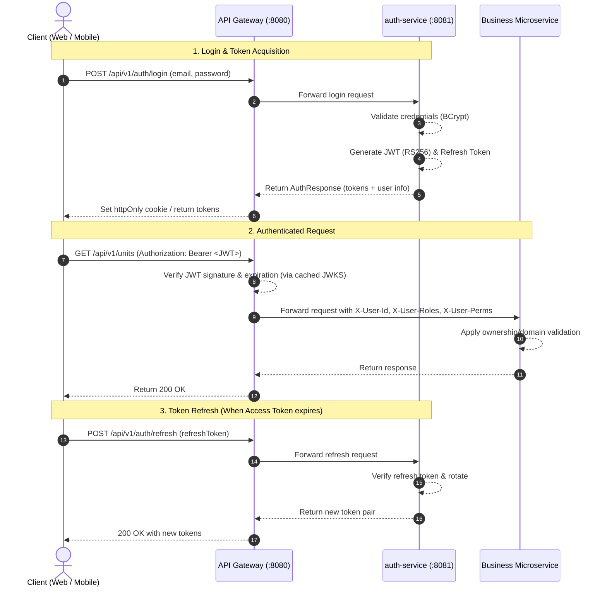

# API Authentication & Authorization Strategy — resi-complex

> **Document Status:** Reference Architecture & Security Specification  
> **Owner:** Julian (R2 — Security Lead)  
> **Applicable Policies:** `00-governance/security-policy.md`, `00-governance/security-rules.md`, `ADR-006`

---

## 1. Authentication Overview

All client communication with `resi-complex` APIs is secured using stateless **JSON Web Tokens (JWT)** based on the **OAuth 2.0 / Bearer Token** pattern. The `auth-service` acts as the centralized Identity & Access Management (IAM) provider responsible for credential validation, token issuance, and role lifecycle management.

### Key Security Principles:
1. **Stateless Verification:** Services and the API Gateway verify token signatures and expiration independently using asymmetric public keys (JWKS) without making synchronous database queries to `auth-service`.
2. **Short-Lived Access Tokens:** Mitigates the risk of token interception by enforcing a 1-hour expiration.
3. **Rotating Refresh Tokens:** Refresh tokens are single-use and rotated on every renewal; compromised refresh tokens trigger immediate revocation of the entire token family.
4. **Least Privilege & Defense in Depth:** Permissions are enforced both globally at the API Gateway (token validity and route filtering) and granularly in the application service layer (business logic and ownership validation).

---

## 2. Token Architecture & Specifications

### 2.1 Access Token (JWT)
- **Format:** RFC 7519 JWT signed with asymmetric **RS256** (RSA Signature with SHA-256).
- **Expiration (`exp`):** 1 hour (3600 seconds) from issuance.
- **Client Storage:** Web clients store tokens in `httpOnly`, `Secure`, `SameSite=Strict` cookies.

#### Standard Token Payload Claims:
```json
{
  "iss": "https://auth.resicomplex.com",
  "sub": "550e8400-e29b-41d4-a716-446655440000",
  "email": "carlos.ruiz@resicomplex.com",
  "name": "Carlos Ruiz",
  "roles": ["RESIDENT"],
  "permissions": [
    "requests:create",
    "requests:read:own",
    "fees:read:own",
    "announcements:read",
    "correspondence:read:own"
  ],
  "unitIds": ["9b1deb4d-3b7d-4bad-9bdd-2b0d7b3dcb6d"],
  "iat": 1726600000,
  "exp": 1726603600,
  "jti": "c1f7b88e-4a6f-4c5a-8d1a-6df2b8f80001"
}
```

### 2.2 Refresh Token
- **Format:** Cryptographically secure opaque string (UUID v4).
- **Expiration:** 7 days.
- **Storage:** Stored hashed (BCrypt) in the `auth_db.refresh_tokens` database table.
- **Rotation Rule:** Each use consumes the refresh token and issues a new pair (`accessToken` + `refreshToken`).

---

## 3. Authentication Flows



---

## 4. Permissions Matrix (Role × Microservice)

The system defines 6 functional roles. Permissions follow the `[resource]:[action]` syntax, with suffixes `:own` or `:assigned` designating fine-grained resource ownership checks.

| Microservice | `ADMIN` | `BOARD_MEMBER` | `RESIDENT` | `MERCHANT` | `SECURITY_GUARD` | `MAINTENANCE_STAFF` |
| :--- | :--- | :--- | :--- | :--- | :--- | :--- |
| **`auth-service`** | `users:*`<br>`roles:*` | Profile read only | Profile read only | Profile read only | Profile read only | Profile read only |
| **`units-service`** | `units:*`<br>`establishments:*` | `units:read` | `units:read:own` | `units:read:own`<br>`establishments:update:own` | `units:read` | `units:read` |
| **`people-service`** | `people:*` | `people:read` | `people:read:own`<br>`people:update:own` | `people:read:own`<br>`people:update:own` | `people:read` | — |
| **`maintenance-service`** | `requests:read`<br>`requests:assign` | `requests:read` | `requests:create`<br>`requests:read:own` | `requests:create`<br>`requests:read:own` | — | `requests:read:assigned`<br>`requests:update:assigned` |
| **`billing-service`** | `fees:*`<br>`rates:*` | `fees:read`<br>`reports:read` | `fees:read:own` | `fees:read:own` | — | — |
| **`communications-service`** | `announcements:*` | `announcements:read` | `announcements:read` *(Residential scope)* | `announcements:read` *(Commercial scope)* | `announcements:read` | `announcements:read` |
| **`access-control-service`** | `visits:read`<br>`correspondence:read` | `visits:read` | `correspondence:read:own` | `correspondence:read:own`<br>`commercial-visits:read:own` | `visits:create`<br>`visits:read`<br>`vehicles:create`<br>`correspondence:create` | — |
| **`finance-approval-service`** | `expenses:create`<br>`expenses:read` | `expenses:approve`<br>`expenses:reject`<br>`expenses:read` | — | — | — | — |
| **`reports-service`** | `reports:read`<br>`audit:read` | `reports:read` | — | — | — | — |

---

## 5. Ownership-Level Authorization

RBAC verification is necessary but not sufficient. When a user requests data belonging to a specific unit or person, the target microservice must verify **resource ownership**:

1. **Rule of Own Data (`:own`):**
   - A `RESIDENT` or `MERCHANT` can only query fee status, maintenance tickets, or correspondence where `unitId` matches one of the `unitIds` embedded in their verified JWT claims.
2. **Rule of Assigned Task (`:assigned`):**
   - A `MAINTENANCE_STAFF` member can only view and update requests where `assignedTo == JWT.sub`.
3. **Enforcement Layer:**
   - Ownership checks are executed in the **Application Service / Use Case layer**, never solely at the Gateway or HTTP Controller level.

---

## 6. Public vs. Protected Endpoints Summary

| Service | Public Endpoints (No Token Required) | Protected Endpoints (Requires `bearerAuth`) |
| :--- | :--- | :--- |
| `auth-service` | `GET /health`<br>`POST /register`<br>`POST /login`<br>`POST /refresh`<br>`GET /jwks` | `POST /logout`<br>`GET/POST /users`<br>`GET/PATCH/DELETE /users/{userId}`<br>`PUT /users/{userId}/roles`<br>`GET /roles` |
| Business Services | `GET /health` | All business operations require a valid JWT passed via `Authorization: Bearer <token>` |
