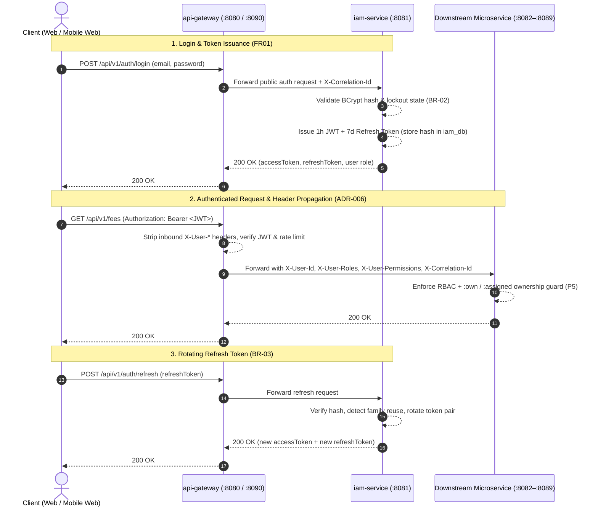

# API Authentication & Authorization Strategy — resi-complex

> **Document Status:** Reference Architecture & Security Specification  
> **Owners:** Fabián Trujillo (Tech Lead & IAM/Gateway) · Julián Losada (Security Lead)  
> **Applicable Policies:** `00-governance/security-policy.md`, `00-governance/security-rules.md`, `ADR-006`, `05-architecture/security-threat-model.md`  
> **Last Synchronized:** 2026-11-21

---

## 1. Authentication Overview

All client communication with `resi-complex` APIs is secured using stateless **JSON Web Tokens (JWT)** under the **OAuth 2.0 / Bearer Token** pattern. **`iam-service`** (`:8081`, OpenAPI contract `auth-service.yaml`, repository `resi-complex-iam-service`) is the centralized Identity & Access Management authority responsible for credential validation, token issuance, staff provisioning/activation (`FR01`, `FR20`), and refresh token rotation.

### Key Security Principles
1. **Centralized Edge Verification:** `api-gateway` (`:8080`, local fallback `:8090`) verifies token signature and expiration before routing to downstream microservices (`ADR-006`), stripping any client-spoofed `X-User-*` headers.
2. **Short-Lived Access Tokens:** Access tokens expire in **1 hour (`3600s`)** to limit exposure if intercepted.
3. **One-Use Rotating Refresh Tokens:** Refresh tokens expire in **7 days**, are persisted BCrypt-hashed in `iam_db.refresh_tokens`, and rotate on every refresh. Reuse of a revoked/rotated token triggers immediate revocation of the entire token family (`BR-03`).
4. **Least Privilege & Ownership Defense-in-Depth (`P5`):** Coarse RBAC is checked at the gateway/controller boundary; fine-grained resource ownership (`:own`, `:assigned`) is strictly enforced inside each microservice's **Application / Use Case layer**.

---

## 2. Token Architecture & Specifications

### 2.1 Access Token (JWT)
- **Format:** RFC 7519 JWT.
- **Signing Algorithm:** **HS256** with a ≥ 256-bit secret (`JWT_SECRET`) in Phase 1 MVP, with a supported upgrade path to asymmetric **RS256** + JWKS (`GET /api/v1/auth/jwks`) per `00-governance/security-policy.md` and `ADR-006`.
- **Expiration (`exp`):** 1 hour (`3600` seconds) from issuance.
- **Client Storage:** Web clients store tokens in `httpOnly`, `Secure`, `SameSite=Strict` cookies (never `localStorage` for refresh tokens).

#### Canonical JWT Payload Claims
```json
{
  "iss": "https://auth.resicomplex.com",
  "sub": "550e8400-e29b-41d4-a716-446655440000",
  "email": "camila.gomez@resicomplex.com",
  "roles": ["PERSON"],
  "permissions": [
    "requests:create",
    "requests:read:own",
    "fees:read:own",
    "announcements:read",
    "correspondence:read:own",
    "preauthorizations:manage:own"
  ],
  "unitIds": ["9b1deb4d-3b7d-4bad-9bdd-2b0d7b3dcb6d"],
  "iat": 1763683200,
  "exp": 1763686800,
  "jti": "c1f7b88e-4a6f-4c5a-8d1a-6df2b8f80001"
}
```
*(Per `00-governance/security-policy.md`, full PII, passwords, and payment details are strictly prohibited in JWT payloads.)*

### 2.2 Refresh Token
- **Format:** Cryptographically secure opaque token (UUID v4 / 256-bit random).
- **Expiration:** 7 days (`604800` seconds).
- **Storage:** Stored BCrypt-hashed in **`iam_db.refresh_tokens`** with `family_id`, `revoked`, and `replaced_by` tracking (`06-data/models.md`).
- **Rotation Rule:** Single-use rotation (`POST /api/v1/auth/refresh`); replay of a previously used token revokes the entire `family_id`.

---

## 3. Authentication & Header Propagation Flows



---

## 4. Canonical Permissions Matrix (5 Authentication Roles × 9 Microservices)

Per `00-governance/security-policy.md`, `01-context/glossary.md`, and `06-data/models.md`, `resi-complex` defines **exactly 5 authentication roles**. Do **NOT** model `RESIDENT`, `COMMERCIAL_OWNER`, or `COMMERCIAL_TENANT` as separate IAM roles — they are business `person_type` subtypes under role **`PERSON`** in `people-service`.

| Microservice (`Port`) | `ADMINISTRATOR` | `BOARD` | `PERSON` *(Resident / Commercial Owner-Tenant)* | `MAINTENANCE_STAFF` | `SECURITY_GUARD` |
| :--- | :--- | :--- | :--- | :--- | :--- |
| **`iam-service`** (`:8081`) | `users:*`, `roles:read` | Own profile read | Own profile read | Own profile read | Own profile read |
| **`communications-service`** (`:8082`) | `announcements:*`, `notifications:read:own` | `announcements:read`, `notifications:read:own` | `announcements:read` *(unit-scope filtered)*, `notifications:read:own` | `announcements:read`, `notifications:read:own` | `announcements:read`, `notifications:read:own` |
| **`units-service`** (`:8083`) | `units:*`, `establishments:*` | `units:read` | `units:read:own` | `units:read` | `units:read` |
| **`billing-service`** (`:8084`) | `fees:*`, `rates:*`, `payments:*` | `fees:read` | `fees:read:own`, `payments:submit:own` | — | — |
| **`people-service`** (`:8085`) | `people:*`, `occupancies:*` | `people:read` | `people:read:own`, `people:update:own` | — | `people:read` *(limited unit lookup)* |
| **`maintenance-service`** (`:8086`) | `requests:read`, `requests:assign` | `requests:read` | `requests:create`, `requests:read:own`, `requests:verify:own` | `requests:read:assigned`, `requests:update:assigned` | — |
| **`access-control-service`** (`:8087`) | `visits:read`, `correspondence:read`, `preauthorizations:read` | `visits:read` | `correspondence:read:own`, `preauthorizations:manage:own` | — | `visits:create`, `visits:read`, `visits:exit`, `vehicles:create`, `correspondence:create`, `correspondence:deliver`, `preauthorizations:checkin` |
| **`finance-approval-service`** (`:8088`) | `expenses:create`, `expenses:read` | `expenses:read`, `expenses:approve`, `expenses:reject` | — | — | — |
| **`reports-service`** (`:8089`) | `reports:read` | `reports:read` | — | — | — |

---

## 5. Ownership-Level Authorization (Principle `P5`)

RBAC role membership alone is never sufficient for unit-scoped or technician-scoped resources:

1. **Rule of Own Unit (`:own`):**
   - A `PERSON` user may only view/act on administration fees (`FR10`), maintenance requests (`FR05–FR06`), correspondence (`FR16`), or visitor pre-authorizations (`FR22`) linked to a `unitId` where they hold an **`ACTIVE`** occupancy in `people-service` (`unit_occupancies.status = 'ACTIVE'`).
   - When a lease ends (`HU-PPL-002`, `BR-07`), setting occupancy to `INACTIVE` immediately revokes `:own` access without deleting audit history.
2. **Rule of Assigned Work Order (`:assigned`):**
   - A `MAINTENANCE_STAFF` user may only view and transition (`ASSIGNED → IN_PROGRESS → WORK_COMPLETED`) requests where `assigned_to == X-User-Id`.
3. **Enforcement Layer:**
   - Verified inside the **Application / Use Case layer** of each microservice — returning `403 Forbidden` (RFC 7807 `ErrorResponse`) on any cross-unit or unassigned access attempt.

---

## 6. Public vs. Protected Endpoints Summary

| Service | Public Endpoints (No JWT Required) | Protected Endpoints (`bearerAuth` Required) |
| :--- | :--- | :--- |
| **`api-gateway`** (`:8080`) | `GET /health` | All `/api/v1/**` routes except public `iam-service` endpoints below |
| **`iam-service`** (`:8081`) | `GET /health`, `POST /api/v1/auth/login`, `POST /api/v1/auth/register`, `POST /api/v1/auth/activate`, `POST /api/v1/auth/refresh`, `GET /api/v1/auth/jwks` | `POST /api/v1/auth/logout`, `GET/POST /api/v1/users`, `GET/PATCH/DELETE /api/v1/users/{userId}`, `PUT /api/v1/users/{userId}/roles`, `GET /api/v1/roles` |
| **8 Business Microservices** (`:8082`–`:8089`) | `GET /health` *(internal readiness probes restricted to private network)* | 100% of `/api/v1/**` business endpoints require valid JWT via Gateway (`Authorization: Bearer <token>`) |
