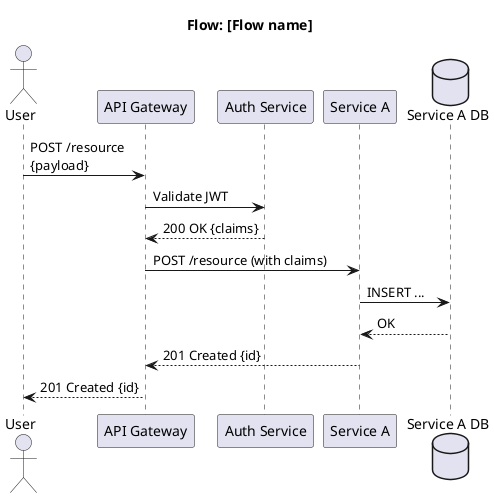
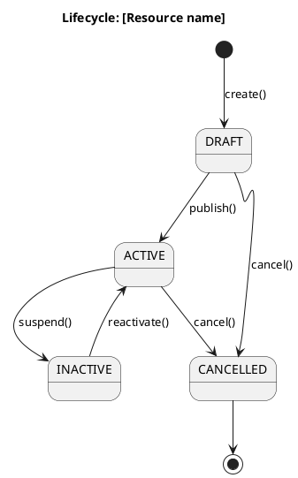
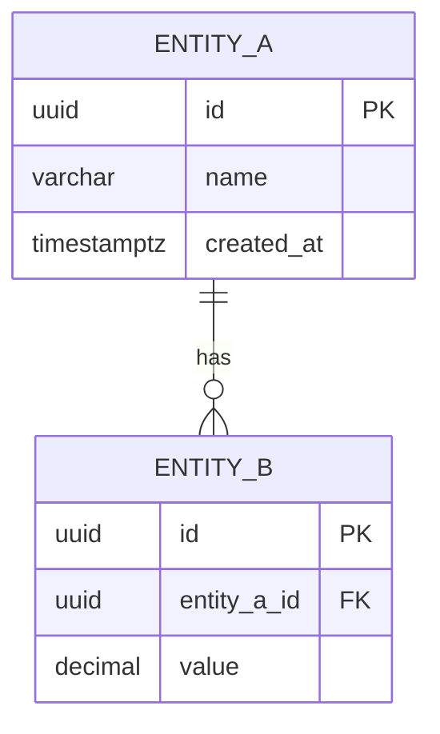

# Diagram Index

> **What to fill in here:** The registry of all system diagrams.
> Diagrams go in `08-uml/diagrams/source/` as PlantUML or Mermaid files.
> Exported renders go in `08-uml/diagrams/rendered/`.

---

## When to create a diagram?

```
✓ When the flow involves 3+ services or actors
✓ When the architecture needs to be communicated to a non-technical stakeholder
✓ When data modeling is complex (ER diagram)
✓ When a bug took more than 2 hours to understand (retroactive sequence diagram)

✗ For simple 2-element flows — code describes them better
✗ To "document for documentation's sake" — an outdated diagram is worse than none
```

---

## File naming

```
[c4-level]-[descriptive-name].[puml|mmd]

Examples:
  c1-system-context.puml
  c2-container-diagram.puml
  c3-auth-service.puml
  seq-create-order.puml
  erd-orders-service.mmd
  state-order-lifecycle.puml
```

---

## Diagram Registry (Synchronized with `resi-complex`)

### Architecture Diagrams (C4 — Mermaid)

| ID | Name | Level | Tool | Location | Description |
|----|------|-------|------|----------|-------------|
| **C4-01** | System Context | C4 L1 | Mermaid | `05-architecture/overview.md` §2 | 5 canonical roles interacting with `resi-complex` |
| **C4-02** | Container Topology | C4 L2 | Mermaid | `05-architecture/overview.md` §3 & `05-architecture/deployment.md` | API Gateway (`:8080`), 9 Spring Boot microservices (`:8081–:8089`), 9 MySQL 8 DBs, RabbitMQ |
| **C4-03** | Microservices Service Map | C4 L2 | Mermaid | `09-microservices/service-catalog.md` §1 | Runtime sync/async routing across all 10 services |

### Sequence Diagrams (Mermaid)

| ID | Name | Tool | Location | Description |
|----|------|------|----------|-------------|
| **SEQ-01** | Authentication, Gateway Propagation & Refresh Rotation | Mermaid | `07-api/authentication.md` §3 | Login (`FR01`), JWT check + `X-User-*` headers (`ADR-006`), refresh rotation (`BR-03`) |
| **SEQ-02** | Maintenance Request Lifecycle (`WORK_COMPLETED` Verification) | Mermaid | `12-ux-ui/navigation-map.md` (Flow 2) | Creation (`FR05`) → assignment → repair → resident verify/reject (`FR06`, `FR07`) |
| **SEQ-03** | Extraordinary Expense Quorum Approval | Mermaid | `12-ux-ui/navigation-map.md` (Flow 4) | Proposal (`FR17`) → Board append-only voting → auto-resolution (`FR18`) |

### Entity-Relationship Diagrams (MySQL 8 — Mermaid)

| ID | Name | Tool | Location | Database(s) |
|----|------|------|----------|-------------|
| **ERD-00** | Complete Cross-Service Data Model (18 Domain Tables) | Mermaid | `06-data/models.md` | All 9 dedicated MySQL 8 schemas (`iam_db`..`reports_db`) |
| **ERD-01** | Per-Service ER Diagrams (`02`–`10`) | Mermaid | `09-microservices/services/*/data-model.md` | One dedicated ER diagram per bounded context |

---

## Diagram templates

### C4 L1 — Context (PlantUML)

```plantuml
@startuml C4-Context
!include https://raw.githubusercontent.com/plantuml-stdlib/C4-PlantUML/master/C4_Context.puml

title System Context — [System Name]

Person(user, "User", "Description of the user")
Person_Ext(admin, "Administrator", "Manages the system")

System(system, "[System Name]", "Description of what it does")

System_Ext(externalSystem, "[External System]", "Description of the external system")

Rel(user, system, "Uses", "HTTPS")
Rel(admin, system, "Administers", "HTTPS")
Rel(system, externalSystem, "Sends data to", "REST API")

@enduml
```

### Sequence diagram (PlantUML)



### State diagram (PlantUML)



### ER diagram (Mermaid)



---

## Tools and rendering

| Tool | For what | How to use |
|------|---------|------------|
| PlantUML | C4, sequence, state, class diagrams | `plantuml -tsvg file.puml` |
| Mermaid | Simple diagrams in Markdown | Native support on GitHub and GitLab |
| draw.io (diagrams.net) | Complex visual diagrams | Export as XML + image |
| Structurizr | C4 model with DSL | For projects that adopt the C4 DSL |

**Rendering pipeline:**
```bash
# Render all PlantUML diagrams
find 08-uml/diagrams/source -name "*.puml" -exec plantuml -tsvg -o ../rendered {} \;

# Or with Docker (without installing PlantUML locally)
docker run --rm -v $(pwd):/data ghcr.io/plantuml/plantuml:latest \
  -tsvg -o /data/08-uml/diagrams/rendered /data/08-uml/diagrams/source/*.puml
```

---

## Correlations

- Architecture view → `05-architecture/overview.md`
- Domain bounded contexts → `02-domain/domain-map.md`
- ER models per service → `09-microservices/services/NN/data-model.md`
