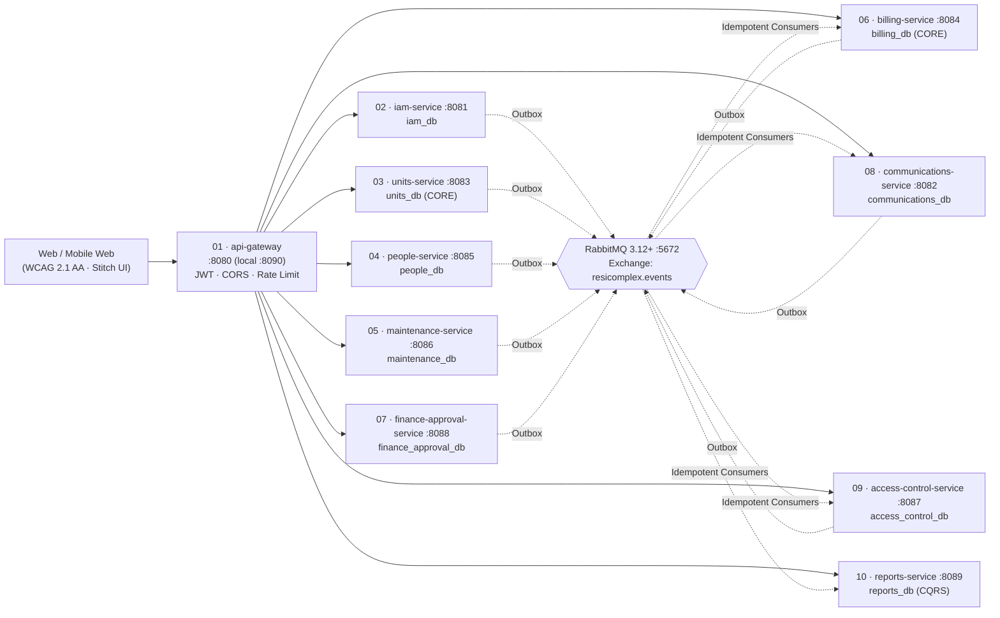

# Microservices Catalog — resi-complex

> **Executive inventory of all 10 services** (`api-gateway` + 9 domain microservices mapped 1:1 to the
> 9 Bounded Contexts in `02-domain/domain-map.md`). Reconciled with `05-architecture/overview.md`,
> `06-data/models.md`, `07-api/contracts/openapi/`, `10-devops/local-setup.md`, and live GitHub
> repositories under `https://github.com/resi-complex`.
> **Last Synchronized:** 2026-11-21

---

## 1. System Topology Map

---

## 2. Complete Service Registry (10 / 10 Services)

| # | Canonical Service | Folder | OpenAPI Contract | Canonical Port | MySQL 8 DB | FRs | Owner | Status |
|---|---|---|---|---|---|---|---|---|
| **01** | `api-gateway` | `01-api-gateway/` | `api-gateway.yaml` | `8080` *(local `:8090`)* | None (stateless) | Edge (`ADR-006`) | Fabián Trujillo | 🟡 Phase 1 Repo Live |
| **02** | `iam-service` *(alias `auth-service`)* | `02-auth-service/` | `auth-service.yaml` | `8081` | `iam_db` | `FR01`, `FR20` | Fabián Trujillo | 🟡 Phase 1 Repo Live |
| **03** | `units-service` | `03-units-service/` | `units-service.yaml` | `8083` | `units_db` | `FR02`, `FR03`, `FR04` | María Alexandra Garzón | 🔴 Repo initialized |
| **04** | `people-service` | `04-people-service/` | `people-service.yaml` | `8085` | `people_db` | `FR21` | María Alexandra Garzón | 🔴 Spec & OpenAPI ready |
| **05** | `maintenance-service` | `05-maintenance-service/` | `maintenance-service.yaml` | `8086` | `maintenance_db` | `FR05`, `FR06` | María Alexandra Garzón | 🔴 Spec & OpenAPI ready |
| **06** | `billing-service` | `06-billing-service/` | `billing-service.yaml` | `8084` | `billing_db` | `FR08`, `FR09`, `FR10` | Félix Murcia | 🟡 Phase 1 Repo Live |
| **07** | `finance-approval-service` *(alias `finance-service`)* | `07-finance-service/` | `finance-service.yaml` | `8088` | `finance_approval_db` *(alias `finance_db`)* | `FR17`, `FR18` | Félix Murcia | 🟡 Phase 1 Repo Live |
| **08** | `communications-service` | `08-communications-service/` | `communications-service.yaml` | `8082` | `communications_db` | `FR07`, `FR11` | Julián Losada | 🟡 Phase 1 Repo Live |
| **09** | `access-control-service` | `09-access-control-service/` | `access-control-service.yaml` | `8087` | `access_control_db` | `FR12`–`FR16`, `FR22` | Julián Losada | 🟡 Phase 1 Repo Live |
| **10** | `reports-service` | `10-reports-service/` | `reports-service.yaml` | `8089` | `reports_db` | `FR19` | Félix Murcia | 🟡 Phase 1 Repo Live |

**Status legend:** 🟢 Production ready (`≥ 80%` coverage + ArchUnit + CI passing) · 🟡 Phase 1 repo live on `https://github.com/resi-complex` · 🔴 Specification, DDL & OpenAPI complete; code implementation pending.

---

## 3. Detailed Specification per Service

### 01 — `api-gateway`
| Field | Value |
|-------|-------|
| **Folder** | [`09-microservices/services/01-api-gateway/`](./services/01-api-gateway/README.md) |
| **Repository** | `https://github.com/resi-complex/resi-complex-api-gateway` |
| **Type** | Edge Infrastructure Service (`ADR-006`) |
| **Port** | `8080` (Docker/canonical) · `8090` (Windows local fallback) |
| **Stack** | Java 25, Spring Boot 4.0.8 / Spring Cloud Gateway, Hexagonal Architecture |
| **DB** | Stateless (in-memory rate limiter in MVP; Redis optional for multi-replica scale) |
| **OpenAPI Contract** | `07-api/contracts/openapi/api-gateway.yaml` |
| **Responsibility** | Single entry point: JWT signature/expiration check, strips client `X-User-*`, injects verified `X-User-Id`/`X-User-Roles`/`X-User-Permissions`/`X-Correlation-Id`, CORS, per-client rate limiting, and reverse proxy to `:8081`–`:8089` |

---

### 02 — `iam-service` *(Folder: `02-auth-service`, Contract: `auth-service.yaml`)*
| Field | Value |
|-------|-------|
| **Folder** | [`09-microservices/services/02-auth-service/`](./services/02-auth-service/README.md) |
| **Repository** | `https://github.com/resi-complex/resi-complex-iam-service` |
| **Bounded Context / Type** | IAM Context — Generic Domain |
| **Port** | `8081` |
| **Stack** | Java 25, Spring Boot 4.0.8, Hexagonal Architecture, Spring Security, BCrypt, Flyway |
| **DB** | MySQL 8.0 (`iam_db`: `users`, `refresh_tokens`, `outbox`) |
| **OpenAPI Contract** | `07-api/contracts/openapi/auth-service.yaml` |
| **FRs** | `FR01` (Login, 5 canonical roles, 1h JWT + 7d rotatable refresh token), `FR20` (Admin staff provisioning & activation) |
| **Events Published** | `UserRegistered` (`iam.user.registered`), `UserActivated` (`iam.user.activated`) |

---

### 03 — `units-service`
| Field | Value |
|-------|-------|
| **Folder** | [`09-microservices/services/03-units-service/`](./services/03-units-service/README.md) |
| **Repository** | `https://github.com/resi-complex/resi-complex-units-service` |
| **Bounded Context / Type** | Units Management Context — **Core Domain** |
| **Port** | `8083` |
| **Stack** | Java 25 (17+ baseline), Spring Boot 4.0.8, Hexagonal Architecture, JPA, Flyway |
| **DB** | MySQL 8.0 (`units_db`: `units`, `commercial_establishments`, `outbox`) |
| **OpenAPI Contract** | `07-api/contracts/openapi/units-service.yaml` |
| **FRs** | `FR02` (Register unit), `FR03` (Edit/soft-delete with `BR-05` debt check), `FR04` (1:1 commercial profile `BR-04`) |
| **Events Published** | `UnitRegistered` (`units.unit.registered`), `UnitUpdated` (`units.unit.updated`), `CommercialEstablishmentRegistered` (`units.commercial-establishment.registered`) |

---

### 04 — `people-service`
| Field | Value |
|-------|-------|
| **Folder** | [`09-microservices/services/04-people-service/`](./services/04-people-service/README.md) |
| **Repository** | `https://github.com/resi-complex/resi-complex-people-service` |
| **Bounded Context / Type** | People Management Context — Supporting Domain (Ley 1581 PII vault) |
| **Port** | `8085` |
| **Stack** | Java 25, Spring Boot 4.0.8, Hexagonal Architecture, JPA, Flyway |
| **DB** | MySQL 8.0 (`people_db`: `person`, `unit_occupancies`, `outbox`) |
| **OpenAPI Contract** | `07-api/contracts/openapi/people-service.yaml` |
| **FRs** | `FR21` (`HU-PPL-001` register Person + Occupancy; `HU-PPL-002` deactivate tenancy on lease end `BR-07`) |
| **Events Published** | `PersonRegistered` (`people.person.registered`), `OccupancyDeactivated` (`people.occupancy.deactivated`) |

---

### 05 — `maintenance-service`
| Field | Value |
|-------|-------|
| **Folder** | [`09-microservices/services/05-maintenance-service/`](./services/05-maintenance-service/README.md) |
| **Repository** | `https://github.com/resi-complex/resi-complex-maintenance-service` |
| **Bounded Context / Type** | Maintenance Context — Supporting Domain |
| **Port** | `8086` |
| **Stack** | Java 25, Spring Boot 4.0.8, Hexagonal Architecture, JPA, Flyway |
| **DB** | MySQL 8.0 (`maintenance_db`: `maintenance_requests`, `outbox`) |
| **OpenAPI Contract** | `07-api/contracts/openapi/maintenance-service.yaml` |
| **FRs** | `FR05` (Create request `PRIVATE_UNIT` / `COMMON_AREA` `BR-08`), `FR06` (Assign, progress, verify/reject `WORK_COMPLETED` `BR-09`) |
| **Events Published** | `MaintenanceRequestCreated` (`maintenance.request.created`), `MaintenanceRequestStatusUpdated` (`maintenance.request.status-updated`) |

---

### 06 — `billing-service`
| Field | Value |
|-------|-------|
| **Folder** | [`09-microservices/services/06-billing-service/`](./services/06-billing-service/README.md) |
| **Repository** | `https://github.com/resi-complex/resi-complex-billing-service` |
| **Bounded Context / Type** | Billing Context — **Core Domain** |
| **Port** | `8084` |
| **Stack** | Java 25, Spring Boot 4.0.8, Hexagonal Architecture, JPA, Flyway, SpringDoc |
| **DB** | MySQL 8.0 (`billing_db`: `administration_fees`, `payments`, `outbox`, `processed_events`) |
| **OpenAPI Contract** | `07-api/contracts/openapi/billing-service.yaml` |
| **FRs** | `FR08` (Monthly fee run), `FR09` (Differentiated residential/commercial tariff frozen at generation `BR-10`), `FR10` (Account statements & partial payments `BR-11`/`BR-12`) |
| **Events Published / Consumed** | Publishes `FeeGenerated`, `FeePaid`; consumes `UnitRegistered`, `UnitUpdated` |

---

### 07 — `finance-approval-service` *(Folder: `07-finance-service`, Contract: `finance-service.yaml`)*
| Field | Value |
|-------|-------|
| **Folder** | [`09-microservices/services/07-finance-service/`](./services/07-finance-service/README.md) |
| **Repository** | `https://github.com/resi-complex/resi-complex-finance-approval-service` |
| **Bounded Context / Type** | Financial Approval Context — Supporting Domain |
| **Port** | `8088` |
| **Stack** | Java 25, Spring Boot 4.0.8, Hexagonal Architecture, JPA, Flyway, SpringDoc |
| **DB** | MySQL 8.0 (`finance_approval_db`, Phase-1 local alias `finance_db`: `expense_proposals`, `approvals`, `outbox`) |
| **OpenAPI Contract** | `07-api/contracts/openapi/finance-service.yaml` |
| **FRs** | `FR17` (Create extraordinary expense proposal with quorum/deadline), `FR18` (Append-only `BOARD` voting & auto-resolution `BR-15`) |
| **Events Published** | `ExpenseProposalCreated`, `ExpenseProposalApproved`, `ExpenseProposalRejected` |

---

### 08 — `communications-service`
| Field | Value |
|-------|-------|
| **Folder** | [`09-microservices/services/08-communications-service/`](./services/08-communications-service/README.md) |
| **Repository** | `https://github.com/resi-complex/resi-complex-communications-service` |
| **Bounded Context / Type** | Communications Context — Supporting Domain |
| **Port** | `8082` |
| **Stack** | Java 25 (17+ baseline), Spring Boot 4.0.8, Hexagonal Architecture, JPA, Flyway |
| **DB** | MySQL 8.0 (`communications_db`: `announcements`, `outbox`, `processed_events`) |
| **OpenAPI Contract** | `07-api/contracts/openapi/communications-service.yaml` |
| **FRs** | `FR07` (Reactive in-app maintenance notifications), `FR11` (Segmented announcements `ALL` / `RESIDENTIAL_ONLY` / `COMMERCIAL_ONLY` & emergency broadcasts) |
| **Events Published / Consumed** | Publishes `AnnouncementPublished`; consumes `MaintenanceRequest*`, `FeeGenerated`, `CorrespondenceReceived`, `ExpenseProposal*` |

---

### 09 — `access-control-service`
| Field | Value |
|-------|-------|
| **Folder** | [`09-microservices/services/09-access-control-service/`](./services/09-access-control-service/README.md) |
| **Repository** | `https://github.com/resi-complex/resi-complex-access-control-service` |
| **Bounded Context / Type** | Access Control Context — Supporting Domain |
| **Port** | `8087` |
| **Stack** | Java 25 (17+ baseline), Spring Boot 4.0.8, Hexagonal Architecture, JPA, Flyway |
| **DB** | MySQL 8.0 (`access_control_db`: `visits`, `visitor_vehicles`, `visitor_preauthorizations`, `correspondence`, `outbox`, `processed_events`) |
| **OpenAPI Contract** | `07-api/contracts/openapi/access-control-service.yaml` |
| **FRs** | `FR12`–`FR14` (Visitor & vehicle entry/exit `BR-13`), `FR15`–`FR16` (Correspondence & 4-digit PIN handover `BR-14`), `FR22` (Visitor pre-authorizations) |
| **Events Published / Consumed** | Publishes `VisitRegistered`, `VisitEnded`, `CorrespondenceReceived`, `CorrespondenceDelivered`; consumes `UnitRegistered` |

---

### 10 — `reports-service`
| Field | Value |
|-------|-------|
| **Folder** | [`09-microservices/services/10-reports-service/`](./services/10-reports-service/README.md) |
| **Repository** | `https://github.com/resi-complex/resi-complex-reports-service` |
| **Bounded Context / Type** | Reports Context — Generic Domain (CQRS Read Model) |
| **Port** | `8089` |
| **Stack** | Java 25, Spring Boot 4.0.8, CQRS Read Store, JPA, Flyway, SpringDoc |
| **DB** | MySQL 8.0 (`reports_db`: `requests_by_status_view`, `pending_fees_view`, `processed_events`) |
| **OpenAPI Contract** | `07-api/contracts/openapi/reports-service.yaml` |
| **FRs** | `FR19` (Executive maintenance status breakdown & pending-fee arrears portfolio for `ADMINISTRATOR` & `BOARD`) |
| **Events Consumed** | `MaintenanceRequestCreated`, `MaintenanceRequestStatusUpdated`, `FeeGenerated`, `FeePaid`, `UnitRegistered` |

---

## 4. Cross-Service Entity Ownership & Communication Matrix

Per `ADR-004` (**Database per Service**), each core entity has exactly **one authoritative owner**. Peer services read or synchronize data exclusively via REST APIs or RabbitMQ Domain Events — never by querying another service's MySQL schema.

| Domain Entity | Authoritative Owner | Downstream Consumers | Integration Mechanism |
|---------------|---------------------|----------------------|-----------------------|
| `User`, `RefreshToken` | `iam-service` (`:8081`) | `api-gateway`, all services | JWT claims + `X-User-*` headers (`ADR-006`) |
| `Unit`, `CommercialEstablishment` | `units-service` (`:8083`) | `billing-service`, `people-service`, `access-control-service`, `communications-service`, `reports-service` | RabbitMQ (`units.unit.registered`, `units.unit.updated`) + REST `GET /api/v1/units/{id}` |
| `Person`, `UnitOccupancy` | `people-service` (`:8085`) | `billing-service`, `maintenance-service`, `access-control-service` | RabbitMQ (`people.person.registered`) + REST `GET /api/v1/units/{unitId}/occupancies` for `:own` checks |
| `MaintenanceRequest` | `maintenance-service` (`:8086`) | `communications-service`, `reports-service` | RabbitMQ (`maintenance.request.created`, `maintenance.request.status-updated`) |
| `AdministrationFee`, `Payment` | `billing-service` (`:8084`) | `units-service` (debt check `BR-05`), `communications-service`, `reports-service` | Sync REST (`units` → `billing` unpaid-fee check) + RabbitMQ (`billing.fee.generated`, `billing.fee.paid`) |
| `Announcement` | `communications-service` (`:8082`) | Web Frontend (`:8080`) | REST `GET /api/v1/announcements` + RabbitMQ (`communications.announcement.published`) |
| `Visit`, `VisitorVehicle`, `Correspondence`, `VisitorPreauthorization` | `access-control-service` (`:8087`) | `communications-service`, `reports-service` | RabbitMQ (`access.visit.*`, `access.correspondence.*`) |
| `ExpenseProposal`, `Approval` | `finance-approval-service` (`:8088`) | `communications-service`, `reports-service` | RabbitMQ (`finance.expense-proposal.*`) |
| `PendingFeesView`, `RequestsByStatusView` | `reports-service` (`:8089`) | Web Frontend (`ADMINISTRATOR`, `BOARD`) | Read-only REST `GET /api/v1/reports/*` fed asynchronously by RabbitMQ |

---

## 5. Correlations

- Architecture Overview & ADRs → `05-architecture/overview.md`, `05-architecture/decisions/README.md`
- Complete MySQL 8 DDL → `06-data/models.md`
- All 10 OpenAPI 3.0.3 Contracts → `07-api/README.md`
- Local Setup & Docker Ports → `10-devops/local-setup.md`
