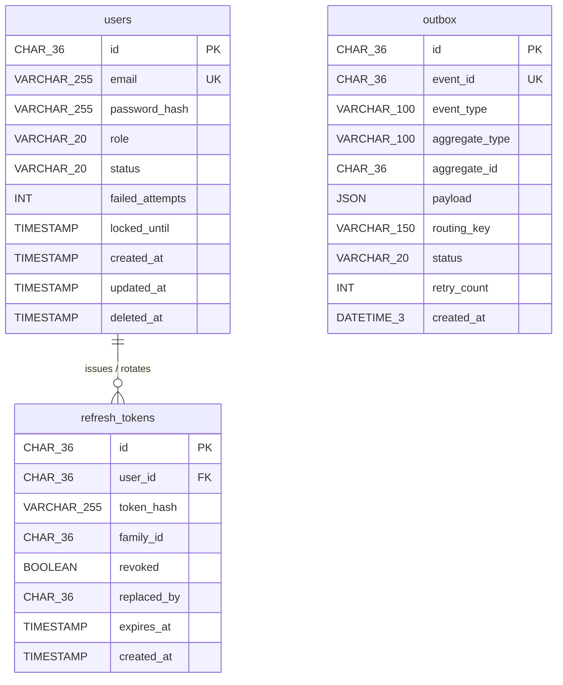

# Data Model — `iam-service` (`iam_db`)

> **Engine:** MySQL 8.0+ (`InnoDB`, `utf8mb4_unicode_ci`) — Dedicated database per `ADR-004`.  
> **Migrations:** Flyway forward-only scripts (`V1__init_iam.sql`) with `spring.jpa.hibernate.ddl-auto=validate`.  
> **Authoritative Source:** Synchronized 1:1 with `06-data/models.md`.

---

## Entity-Relationship Diagram

---

## Tables Owned by `iam_db`

### 1. `users`
- Stores one authentication account per user (`FR01`, `FR20`).
- **Constraints:**
  - `uq_users_email`: Unique email across active/historical accounts.
  - `chk_users_role`: `role IN ('ADMINISTRATOR','BOARD','PERSON','MAINTENANCE_STAFF','SECURITY_GUARD')`.
  - `chk_users_status`: `status IN ('PENDING_ACTIVATION','ACTIVE','INACTIVE','LOCKED')`.
- **Security:** `password_hash` stores BCrypt hashes (cost ≥ 12); `failed_attempts` and `locked_until` enforce `BR-02` (5 failures → 15 min lock).

### 2. `refresh_tokens`
- Persists 7-day rotatable refresh tokens (`BR-03`, `ADR-006`).
- **Constraints:**
  - `fk_refresh_tokens_user`: `FOREIGN KEY (user_id) REFERENCES users(id) ON DELETE CASCADE`.
  - `token_hash` stores BCrypt hash of the opaque token (never plaintext).
  - `family_id` + `revoked` + `replaced_by` enable immediate revocation of the entire session family if a rotated token is replayed.

### 3. `outbox`
- Transactional Outbox table (`ADR-005`) storing `UserRegistered` and `UserActivated` events committed atomically with user mutations.
