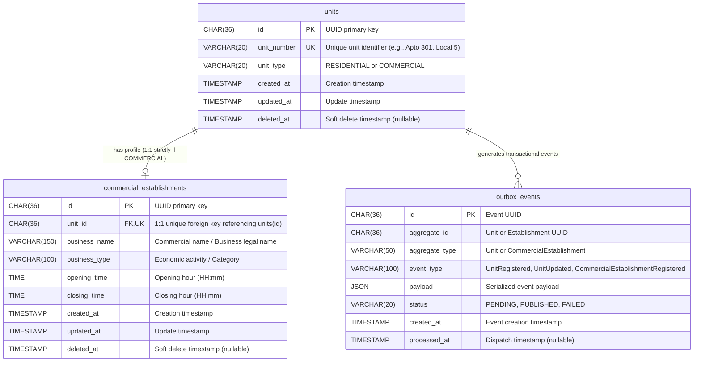

# Data Model — Units Service (`units_db`)

> **Database:** `units_db`  
> **Engine:** MySQL 8.0 (InnoDB, `utf8mb4_unicode_ci`)  
> **Schema Management:** Flyway (`src/main/resources/db/migration/`)

---

## 1. Entity-Relationship Diagram



---

## 2. Table Definitions (DDL)

### Table `units`

Authoritative table of all physical spaces in the residential-commercial complex (`FR02`, `FR03`).

```sql
CREATE TABLE units (
  id              CHAR(36)     NOT NULL,
  unit_number     VARCHAR(20)  NOT NULL,
  unit_type       VARCHAR(20)  NOT NULL,

  created_at      TIMESTAMP    NOT NULL DEFAULT CURRENT_TIMESTAMP,
  updated_at      TIMESTAMP    NOT NULL DEFAULT CURRENT_TIMESTAMP ON UPDATE CURRENT_TIMESTAMP,
  deleted_at      TIMESTAMP    NULL,

  PRIMARY KEY (id),
  CONSTRAINT uq_units_number UNIQUE (unit_number),
  CONSTRAINT chk_units_type CHECK (unit_type IN ('RESIDENTIAL', 'COMMERCIAL')),

  INDEX idx_units_type (unit_type),
  INDEX idx_units_deleted (deleted_at)
) ENGINE=InnoDB DEFAULT CHARSET=utf8mb4 COLLATE=utf8mb4_unicode_ci;
```

### Table `commercial_establishments`

Stores business profile details strictly 1:1 for units whose `unit_type = 'COMMERCIAL'` (`FR04`, `AGGR-INV-001`).

```sql
CREATE TABLE commercial_establishments (
  id              CHAR(36)     NOT NULL,
  unit_id         CHAR(36)     NOT NULL,
  business_name   VARCHAR(150) NOT NULL,
  business_type   VARCHAR(100) NOT NULL,
  opening_time    TIME         NOT NULL,
  closing_time    TIME         NOT NULL,

  created_at      TIMESTAMP    NOT NULL DEFAULT CURRENT_TIMESTAMP,
  updated_at      TIMESTAMP    NOT NULL DEFAULT CURRENT_TIMESTAMP ON UPDATE CURRENT_TIMESTAMP,
  deleted_at      TIMESTAMP    NULL,

  PRIMARY KEY (id),
  CONSTRAINT uq_comm_est_unit_id UNIQUE (unit_id),
  CONSTRAINT fk_comm_est_unit FOREIGN KEY (unit_id)
    REFERENCES units(id) ON DELETE RESTRICT ON UPDATE RESTRICT,

  INDEX idx_comm_est_deleted (deleted_at)
) ENGINE=InnoDB DEFAULT CHARSET=utf8mb4 COLLATE=utf8mb4_unicode_ci;
```

### Table `outbox_events`

Transactional outbox table ensuring at-least-once event publication without distributed two-phase commits.

```sql
CREATE TABLE outbox_events (
  id              CHAR(36)     NOT NULL,
  aggregate_id    CHAR(36)     NOT NULL,
  aggregate_type  VARCHAR(50)  NOT NULL,
  event_type      VARCHAR(100) NOT NULL,
  payload         JSON         NOT NULL,
  status          VARCHAR(20)  NOT NULL DEFAULT 'PENDING',
  created_at      TIMESTAMP    NOT NULL DEFAULT CURRENT_TIMESTAMP,
  processed_at    TIMESTAMP    NULL,

  PRIMARY KEY (id),
  INDEX idx_outbox_status_created (status, created_at)
) ENGINE=InnoDB DEFAULT CHARSET=utf8mb4 COLLATE=utf8mb4_unicode_ci;
```

---

## 3. Data Dictionary

| Table | Column | Type | Nullable | Description |
|---|---|---|---|---|
| `units` | `id` | `CHAR(36)` | No | Identificador único UUID v4 de la unidad física |
| `units` | `unit_number` | `VARCHAR(20)` | No | Nomenclatura visible única del conjunto (ej. `Apto 301`, `Local 5`) |
| `units` | `unit_type` | `VARCHAR(20)` | No | Clasificador de negocio (`RESIDENTIAL` o `COMMERCIAL`) |
| `units` | `deleted_at` | `TIMESTAMP` | Yes | Marca de tiempo de baja lógica (`NULL` si está activa) |
| `commercial_establishments` | `id` | `CHAR(36)` | No | Identificador único UUID v4 del perfil comercial |
| `commercial_establishments` | `unit_id` | `CHAR(36)` | No | Clave foránea única a `units.id` que garantiza cardinalidad 1:1 estricta |
| `commercial_establishments` | `business_name` | `VARCHAR(150)` | No | Razón social o nombre comercial del establecimiento |
| `commercial_establishments` | `business_type` | `VARCHAR(100)` | No | Categoría o actividad económica (ej. panadería, minimarket, peluquería) |
| `commercial_establishments` | `opening_time` | `TIME` | No | Horario de inicio de atención comercial |
| `commercial_establishments` | `closing_time` | `TIME` | No | Horario de cierre de atención comercial |

---

## 4. Invariants & Data Integrity Rules

1. **Restricción 1:1 Estricta (`uq_comm_est_unit_id`):** Un local comercial tiene exactamente un establecimiento; no es una relación 1:N.
2. **Validación en Capa de Aplicación (`BR-04`):** El motor MySQL no permite subconsultas en restricciones `CHECK`. Por tanto, el servicio de dominio valida antes de insertar que `units.unit_type = 'COMMERCIAL'`. Cualquier intento sobre una unidad `RESIDENTIAL` genera una excepción `InvalidUnitTypeException` mapeada a HTTP 422.
3. **Bloqueo de Borrado por Cartera (`BR-05`):** Antes de ejecutar el soft-delete (`deleted_at`), el servicio consulta vía REST al `billing-service`. Si la unidad registra cuotas en estado `PENDING`, `PARTIALLY_PAID` o `OVERDUE`, se deniega con HTTP 409 Conflict.
