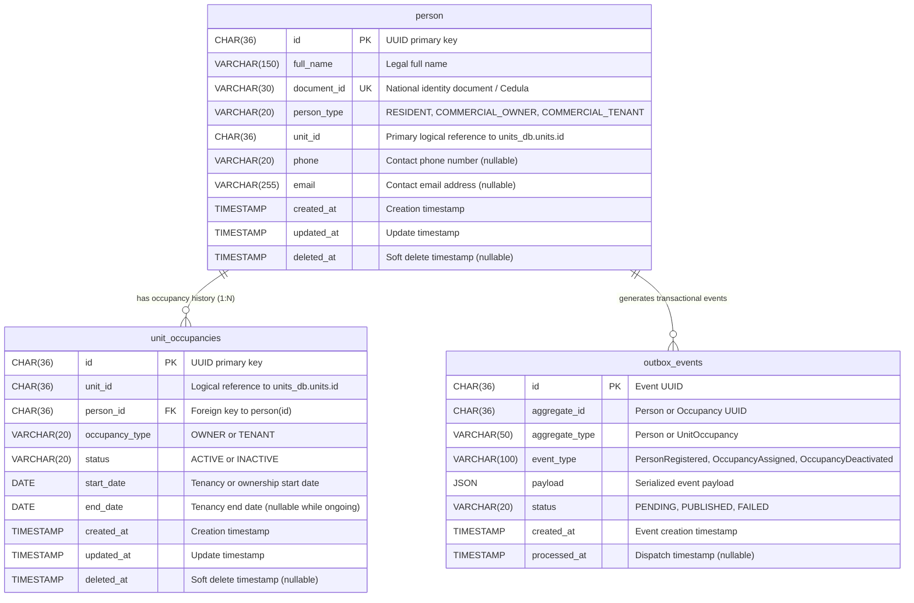

# Data Model — People Service (`people_db`)

> **Database:** `people_db`  
> **Engine:** MySQL 8.0 (InnoDB, `utf8mb4_unicode_ci`)  
> **Schema Management:** Flyway (`src/main/resources/db/migration/`)

---

## 1. Entity-Relationship Diagram



---

## 2. Table Definitions (DDL)

### Table `person`

Authoritative profile of a Resident or Commercial Owner/Tenant per the ubiquitous language (`FR21`).

```sql
CREATE TABLE person (
  id              CHAR(36)     NOT NULL,
  full_name       VARCHAR(150) NOT NULL,
  document_id     VARCHAR(30)  NOT NULL,
  person_type     VARCHAR(20)  NOT NULL,
  unit_id         CHAR(36)     NULL,          -- Logical ref → units_db.units.id; full history in unit_occupancies
  phone           VARCHAR(20)  NULL,
  email           VARCHAR(255) NULL,

  created_at      TIMESTAMP    NOT NULL DEFAULT CURRENT_TIMESTAMP,
  updated_at      TIMESTAMP    NOT NULL DEFAULT CURRENT_TIMESTAMP ON UPDATE CURRENT_TIMESTAMP,
  deleted_at      TIMESTAMP    NULL,

  PRIMARY KEY (id),
  CONSTRAINT uq_person_document UNIQUE (document_id),
  CONSTRAINT chk_person_type CHECK (person_type IN ('RESIDENT', 'COMMERCIAL_OWNER', 'COMMERCIAL_TENANT')),

  INDEX idx_person_unit_id (unit_id),
  INDEX idx_person_deleted (deleted_at)
) ENGINE=InnoDB DEFAULT CHARSET=utf8mb4 COLLATE=utf8mb4_unicode_ci;
```

### Table `unit_occupancies`

Tracks formal tenancy, ownership, and lease lifecycles for units (`FR21`, `HU-PPL-001`, `HU-PPL-002`). Associates a `person` with a `unit` under an explicit role (`OWNER` / `TENANT`), status, and validity interval.

```sql
CREATE TABLE unit_occupancies (
  id              CHAR(36)     NOT NULL,
  unit_id         CHAR(36)     NOT NULL,      -- Logical ref → units_db.units.id
  person_id       CHAR(36)     NOT NULL,
  occupancy_type  VARCHAR(20)  NOT NULL,
  status          VARCHAR(20)  NOT NULL DEFAULT 'ACTIVE',
  start_date      DATE         NOT NULL,
  end_date        DATE         NULL,

  created_at      TIMESTAMP    NOT NULL DEFAULT CURRENT_TIMESTAMP,
  updated_at      TIMESTAMP    NOT NULL DEFAULT CURRENT_TIMESTAMP ON UPDATE CURRENT_TIMESTAMP,
  deleted_at      TIMESTAMP    NULL,

  PRIMARY KEY (id),
  CONSTRAINT fk_occupancies_person FOREIGN KEY (person_id)
    REFERENCES person(id) ON DELETE RESTRICT ON UPDATE RESTRICT,
  CONSTRAINT chk_occupancies_type CHECK (occupancy_type IN ('OWNER', 'TENANT')),
  CONSTRAINT chk_occupancies_status CHECK (status IN ('ACTIVE', 'INACTIVE')),
  CONSTRAINT chk_occupancies_dates CHECK (end_date IS NULL OR end_date >= start_date),

  INDEX idx_occupancies_unit_status (unit_id, status),
  INDEX idx_occupancies_person_status (person_id, status),
  INDEX idx_occupancies_deleted (deleted_at)
) ENGINE=InnoDB DEFAULT CHARSET=utf8mb4 COLLATE=utf8mb4_unicode_ci;
```

### Table `outbox_events`

Transactional outbox table ensuring reliable event publishing across microservices.

```sql
CREATE TABLE outbox_events (
  id              CHAR(36)     NOT NULL,
  aggregate_id    CHAR(36)     NOT NULL,
  aggregate_type  VARCHAR(50)  NOT NULL,
  event_type      VARCHAR(100) NOT NULL,
  payload         JSON         NOT NULL,
  status          VARCHAR(20)  NOT NULL DEFAULT 'PENDING',
  created_at      TIMESTAMP    NOT NULL DEFAULT CURRENT_TIMESTAMP,
  processed_at    TIMESTAMP    NULL,

  PRIMARY KEY (id),
  INDEX idx_outbox_status_created (status, created_at)
) ENGINE=InnoDB DEFAULT CHARSET=utf8mb4 COLLATE=utf8mb4_unicode_ci;
```

---

## 3. Data Dictionary

| Table | Column | Type | Nullable | Description |
|---|---|---|---|---|
| `person` | `id` | `CHAR(36)` | No | Identificador único UUID v4 de la persona |
| `person` | `full_name` | `VARCHAR(150)` | No | Nombre legal completo de la persona |
| `person` | `document_id` | `VARCHAR(30)` | No | Documento de identidad único nacional |
| `person` | `person_type` | `VARCHAR(20)` | No | Subtipo de negocio (`RESIDENT`, `COMMERCIAL_OWNER`, `COMMERCIAL_TENANT`) |
| `person` | `unit_id` | `CHAR(36)` | Yes | Referencia lógica a la unidad actual en `units-service` |
| `person` | `phone` | `VARCHAR(20)` | Yes | Número de teléfono de contacto |
| `person` | `email` | `VARCHAR(255)` | Yes | Correo electrónico de contacto |
| `unit_occupancies` | `id` | `CHAR(36)` | No | Identificador único UUID v4 de la ocupación |
| `unit_occupancies` | `unit_id` | `CHAR(36)` | No | Referencia lógica a la unidad física en `units-service` |
| `unit_occupancies` | `person_id` | `CHAR(36)` | No | Clave foránea a la tabla local `person.id` |
| `unit_occupancies` | `occupancy_type` | `VARCHAR(20)` | No | Calidad de la ocupación (`OWNER` o `TENANT`) |
| `unit_occupancies` | `status` | `VARCHAR(20)` | No | Estado de vinculación (`ACTIVE` o `INACTIVE`) |
| `unit_occupancies` | `start_date` | `DATE` | No | Fecha de inicio de ocupación o contrato |
| `unit_occupancies` | `end_date` | `DATE` | Yes | Fecha de terminación de contrato o desocupación (`NULL` si está en curso) |

---

## 4. Invariants & Data Integrity Rules

1. **Desacoplamiento Base de Datos por Servicio:** `person.unit_id` y `unit_occupancies.unit_id` son referencias lógicas (`CHAR(36)`), no claves foráneas físicas hacia `units_db`. La validación de existencia se realiza vía HTTP contra `units-service` en la capa de aplicación.
2. **Invariante de Fechas de Tenencia (`chk_occupancies_dates`):** Si `end_date` está presente, debe ser mayor o igual a `start_date`.
3. **Preservación de Historial:** Al desactivar una ocupación por terminación de contrato (`HU-PPL-002`), el registro se actualiza a `status = 'INACTIVE'` con su `end_date`; no se borra físicamente para permitir auditoría legal y financiera.
