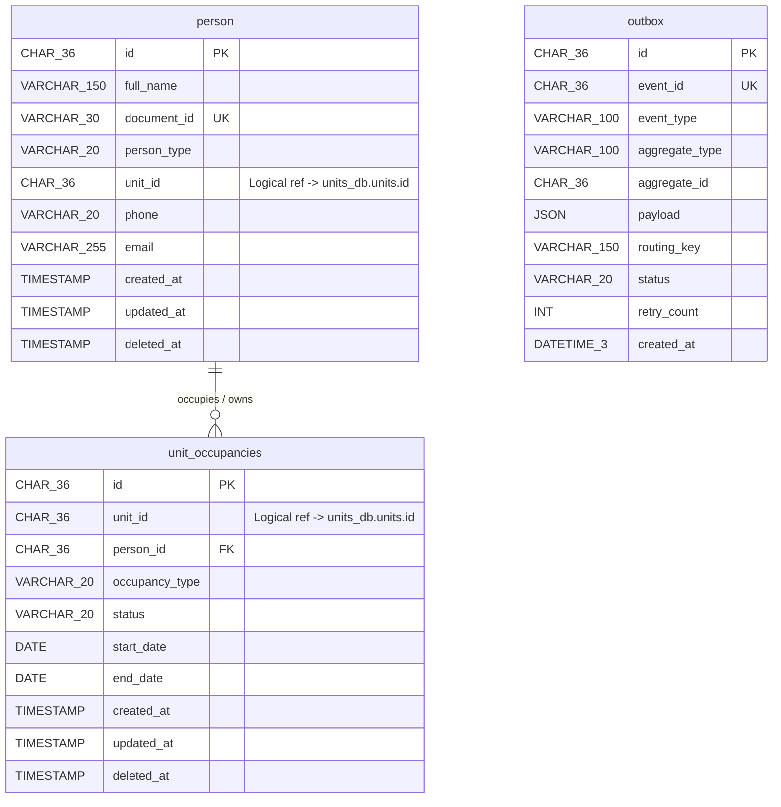

# Data Model — `people-service` (`people_db`)

> **Engine:** MySQL 8.0+ (`InnoDB`, `utf8mb4_unicode_ci`) — Dedicated database per `ADR-004`.  
> **Migrations:** Flyway forward-only scripts + `spring.jpa.hibernate.ddl-auto=validate`.  
> **Authoritative Source:** Synchronized 1:1 with `06-data/models.md`.

---

## Entity-Relationship Diagram

---

## Key Constraints & Invariants

1. `uq_person_document`: Unique government `document_id` across `person`.
2. `chk_person_type`: `person_type IN ('RESIDENT','COMMERCIAL_OWNER','COMMERCIAL_TENANT')` (`BR-06`).
3. `fk_occupancies_person`: `FOREIGN KEY (person_id) REFERENCES person(id) ON DELETE RESTRICT ON UPDATE RESTRICT`.
4. `chk_occupancies_type`: `occupancy_type IN ('OWNER','TENANT')`.
5. `chk_occupancies_status`: `status IN ('ACTIVE','INACTIVE')`.
6. `chk_occupancies_dates`: `end_date IS NULL OR end_date >= start_date`.
7. Composite indexes `idx_occupancies_unit_status (unit_id, status)` and `idx_occupancies_person_status (person_id, status)` ensure sub-millisecond `:own` ownership checks (`BR-07`).
