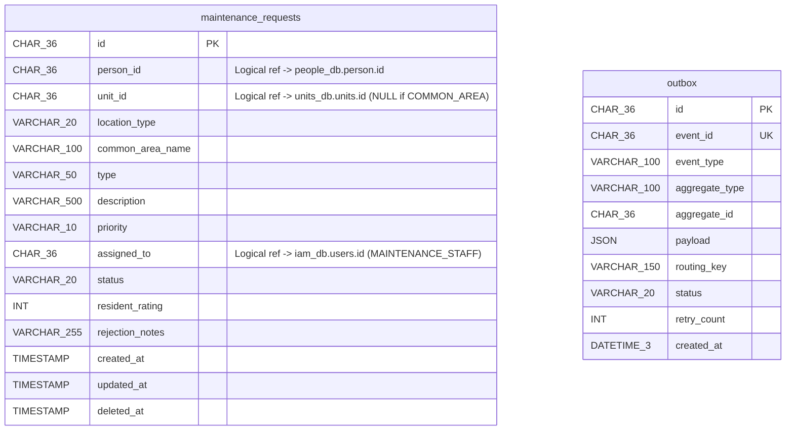

# Data Model — `maintenance-service` (`maintenance_db`)

> **Engine:** MySQL 8.0+ (`InnoDB`, `utf8mb4_unicode_ci`) — Dedicated database per `ADR-004`.  
> **Migrations:** Flyway forward-only scripts + `spring.jpa.hibernate.ddl-auto=validate`.  
> **Authoritative Source:** Synchronized 1:1 with `06-data/models.md`.

---

## Entity-Relationship Diagram

---

## Key Constraints & Domain Invariants

1. `chk_maintreq_location_type`: `location_type IN ('PRIVATE_UNIT','COMMON_AREA')`.
2. `chk_maintreq_location_ref` (`BR-08` / `INV-001`): `(location_type = 'PRIVATE_UNIT' AND unit_id IS NOT NULL) OR (location_type = 'COMMON_AREA' AND common_area_name IS NOT NULL)`.
3. `chk_maintreq_priority`: `priority IN ('LOW','MEDIUM','HIGH','URGENT')`.
4. `chk_maintreq_status` (`BR-09`): `status IN ('PENDING','ASSIGNED','IN_PROGRESS','WORK_COMPLETED','RESOLVED')`.
5. `chk_maintreq_rating`: `resident_rating IS NULL OR resident_rating BETWEEN 1 AND 5`.
6. Indexes on `(person_id)`, `(unit_id)`, `(status)`, `(assigned_to)`, and `(deleted_at)` support fast role-scoped `:own` and `:assigned` listings.
