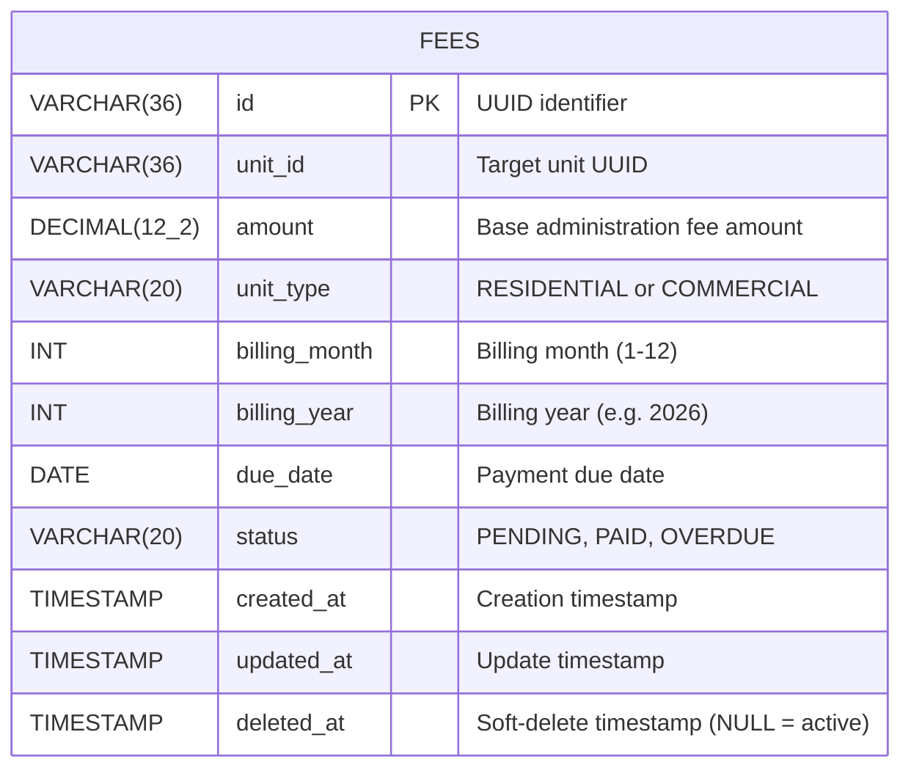

# Data Model — Billing Service (`billing_db`)

> Dedicated database schema for `resi-complex-billing-service`.  
> Engine: **MySQL 8.0+** | Charset: `utf8mb4` | Collation: `utf8mb4_unicode_ci`  
> Schema evolution managed strictly via **Flyway** migrations (`V1__init_billing.sql`).

---

## 1. Entity-Relationship Diagram



---

## 2. Table Specifications

### Table: `fees`

**Purpose:** Stores monthly administration fee invoices generated per residential or commercial unit (`FR08`, `FR09`, `FR10`).

```sql
CREATE TABLE fees (
    id VARCHAR(36) PRIMARY KEY,
    unit_id VARCHAR(36) NOT NULL,
    amount DECIMAL(12,2) NOT NULL,
    unit_type VARCHAR(20) NOT NULL, -- 'RESIDENTIAL' o 'COMMERCIAL'
    billing_month INT NOT NULL,     -- 1 a 12
    billing_year INT NOT NULL,      -- Ej: 2026
    due_date DATE NOT NULL,
    status VARCHAR(20) NOT NULL DEFAULT 'PENDING', -- 'PENDING', 'PAID', 'OVERDUE'
    created_at TIMESTAMP NOT NULL DEFAULT CURRENT_TIMESTAMP,
    updated_at TIMESTAMP NOT NULL DEFAULT CURRENT_TIMESTAMP ON UPDATE CURRENT_TIMESTAMP,
    deleted_at TIMESTAMP NULL
);

CREATE INDEX idx_fees_unit ON fees (unit_id);
CREATE INDEX idx_fees_status ON fees (status);
CREATE INDEX idx_fees_period ON fees (billing_year, billing_month);
```

---

## 3. Data Dictionary

| Column | Type | Nullable | Default | Description |
|--------|------|:--------:|---------|-------------|
| `id` | `VARCHAR(36)` | No | — | Unique identifier generated as UUID v4 |
| `unit_id` | `VARCHAR(36)` | No | — | Logical reference to `units.id` in `units-service` |
| `amount` | `DECIMAL(12,2)` | No | — | Differentiated base fee amount in COP |
| `unit_type` | `VARCHAR(20)` | No | — | Frozen unit classification at generation: `RESIDENTIAL` or `COMMERCIAL` |
| `billing_month` | `INT` | No | — | Month of the billing period (`1` to `12`) |
| `billing_year` | `INT` | No | — | Four-digit year of the billing period (e.g., `2026`) |
| `due_date` | `DATE` | No | — | Deadline for timely payment before late surcharges apply |
| `status` | `VARCHAR(20)` | No | `'PENDING'` | Lifecycle state: `PENDING`, `PAID`, `OVERDUE` |
| `created_at` | `TIMESTAMP` | No | `CURRENT_TIMESTAMP` | Audit field: insertion timestamp |
| `updated_at` | `TIMESTAMP` | No | `CURRENT_TIMESTAMP` | Audit field: automatic update timestamp |
| `deleted_at` | `TIMESTAMP` | Yes | `NULL` | Soft delete flag (`NULL` = active record) |

---

## 4. Modeling Decisions

1. **Frozen Unit Classification (`unit_type`):** Storing `unit_type` directly in `fees` preserves historical financial integrity even if a unit's classification changes in future periods (`BR-10`).
2. **Compound Period Indexing (`idx_fees_period`):** Optimizes monthly portfolio queries and duplicate period verification `(unit_id, billing_month, billing_year)`.
3. **Hibernate DDL Validation:** `spring.jpa.hibernate.ddl-auto=validate` guarantees that JPA entities match `V1__init_billing.sql` without unintended schema mutations.
