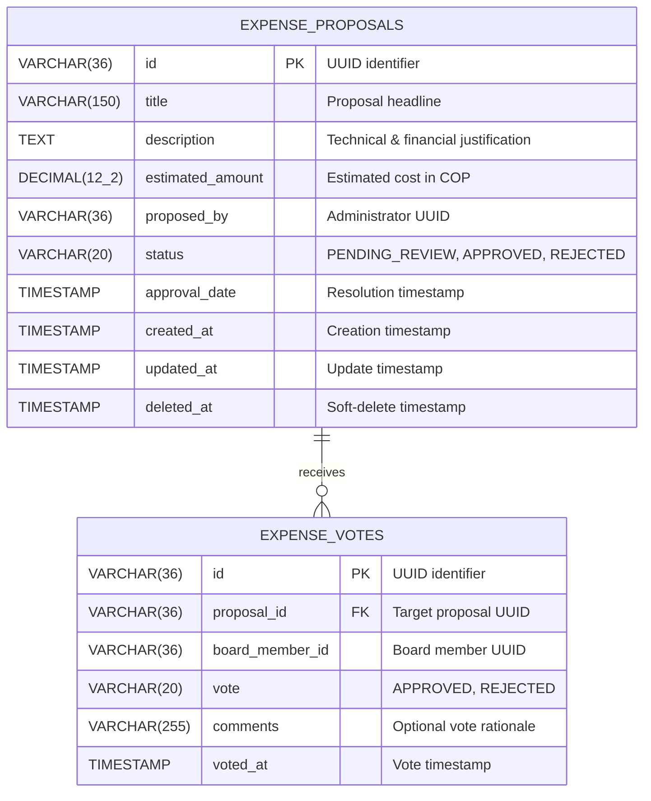

# Data Model — Finance Approval Service (`finance_db`)

> Dedicated database schema for `resi-complex-finance-approval-service`.  
> Engine: **MySQL 8.0+** | Charset: `utf8mb4` | Collation: `utf8mb4_unicode_ci`  
> Schema evolution managed strictly via **Flyway** migrations (`V1__init_finance.sql`).

---

## 1. Entity-Relationship Diagram



---

## 2. Table Specifications

### Table: `expense_proposals`

**Purpose:** Stores extraordinary expense proposals submitted by the administrator for Board approval (`FR17`).

```sql
CREATE TABLE expense_proposals (
    id VARCHAR(36) PRIMARY KEY,
    title VARCHAR(150) NOT NULL,
    description TEXT NOT NULL,
    estimated_amount DECIMAL(12,2) NOT NULL,
    proposed_by VARCHAR(36) NOT NULL,
    status VARCHAR(20) NOT NULL DEFAULT 'PENDING_REVIEW', -- PENDING_REVIEW, APPROVED, REJECTED
    approval_date TIMESTAMP NULL,
    created_at TIMESTAMP NOT NULL DEFAULT CURRENT_TIMESTAMP,
    updated_at TIMESTAMP NOT NULL DEFAULT CURRENT_TIMESTAMP ON UPDATE CURRENT_TIMESTAMP,
    deleted_at TIMESTAMP NULL
);
```

### Table: `expense_votes`

**Purpose:** Stores immutable votes cast by Board members (`FR18`).

```sql
CREATE TABLE expense_votes (
    id VARCHAR(36) PRIMARY KEY,
    proposal_id VARCHAR(36) NOT NULL,
    board_member_id VARCHAR(36) NOT NULL,
    vote VARCHAR(20) NOT NULL, -- 'APPROVED', 'REJECTED'
    comments VARCHAR(255) NULL,
    voted_at TIMESTAMP NOT NULL DEFAULT CURRENT_TIMESTAMP
);
```

---

## 3. Data Dictionary

| Table | Column | Type | Nullable | Description |
|-------|--------|------|:--------:|-------------|
| `expense_proposals` | `estimated_amount` | `DECIMAL(12,2)` | No | Estimated cost of the extraordinary expense in COP |
| `expense_proposals` | `status` | `VARCHAR(20)` | No | `PENDING_REVIEW` initially; transitions terminally to `APPROVED` or `REJECTED` |
| `expense_proposals` | `approval_date` | `TIMESTAMP` | Yes | Timestamp recorded when majority quorum is reached |
| `expense_votes` | `board_member_id` | `VARCHAR(36)` | No | UUID of the voting Board member |
| `expense_votes` | `vote` | `VARCHAR(20)` | No | Decision: `APPROVED` or `REJECTED` |

---

## 4. Modeling Decisions

1. **Append-Only Audit Trail (`expense_votes`):** Votes have no `updated_at` or `deleted_at` columns because Board decisions are legally immutable once cast (`BR-15`).
2. **Terminal Proposal Resolution:** Once `status` transitions out of `PENDING_REVIEW`, the application layer rejects any additional votes with `409 Conflict`.
