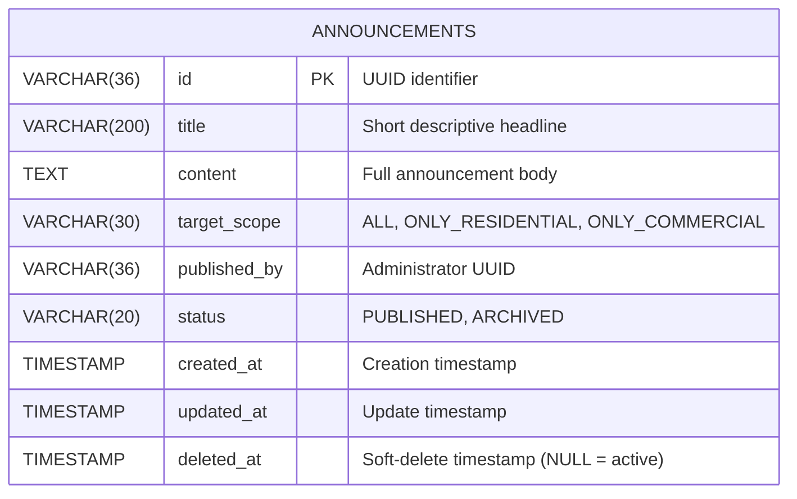

# Data Model — Communications Service (`communications_db`)

> Dedicated database schema for `resi-complex-communications-service`.  
> Engine: **MySQL 8.0+** | Charset: `utf8mb4` | Collation: `utf8mb4_unicode_ci`  
> Schema evolution managed strictly via **Flyway** migrations.

---

## 1. Entity-Relationship Diagram



---

## 2. Table Specifications

### Table: `announcements`

**Purpose:** Stores administrative notices, circulars, and announcements broadcast to the community with audience segmentation (`FR12`).

```sql
CREATE TABLE announcements (
    id              VARCHAR(36)  PRIMARY KEY,
    title           VARCHAR(200) NOT NULL,
    content         TEXT         NOT NULL,
    target_scope    VARCHAR(30)  NOT NULL, -- 'ALL', 'ONLY_RESIDENTIAL', 'ONLY_COMMERCIAL'
    published_by    VARCHAR(36)  NOT NULL,
    status          VARCHAR(20)  NOT NULL DEFAULT 'PUBLISHED',
    created_at      TIMESTAMP    NOT NULL DEFAULT CURRENT_TIMESTAMP,
    updated_at      TIMESTAMP    NOT NULL DEFAULT CURRENT_TIMESTAMP ON UPDATE CURRENT_TIMESTAMP,
    deleted_at      TIMESTAMP    NULL
);

CREATE INDEX idx_announcements_scope ON announcements (target_scope);
CREATE INDEX idx_announcements_status ON announcements (status);
CREATE INDEX idx_announcements_deleted ON announcements (deleted_at);
```

---

## 3. Data Dictionary

| Column | Type | Nullable | Default | Description |
|--------|------|:--------:|---------|-------------|
| `id` | `VARCHAR(36)` | No | — | Unique identifier generated as UUID v4 |
| `title` | `VARCHAR(200)` | No | — | Headline of the bulletin / notice |
| `content` | `TEXT` | No | — | Markdown or plain text message body |
| `target_scope` | `VARCHAR(30)` | No | — | Audience target: `ALL`, `ONLY_RESIDENTIAL`, `ONLY_COMMERCIAL` |
| `published_by` | `VARCHAR(36)` | No | — | Cross-service logical reference to `users.id` in `auth-service` |
| `status` | `VARCHAR(20)` | No | `'PUBLISHED'` | Lifecycle state: `PUBLISHED`, `ARCHIVED` |
| `created_at` | `TIMESTAMP` | No | `CURRENT_TIMESTAMP` | Audit field: insertion timestamp |
| `updated_at` | `TIMESTAMP` | No | `CURRENT_TIMESTAMP` | Audit field: automatic update timestamp |
| `deleted_at` | `TIMESTAMP` | Yes | `NULL` | Soft delete flag: `NULL` means active; non-null indicates deletion date |

---

## 4. Modeling Decisions

1. **Soft Delete by Default:** Physical records are never deleted via SQL `DELETE`. Marking `deleted_at = CURRENT_TIMESTAMP` guarantees auditability under Ley 675 / Ley 1581.
2. **`target_scope` Enumeration:** Natively enforces the project's core differentiator (residential vs. commercial segmentation) at the database layer.
3. **Hibernate DDL Validation:** In production and local setups, `spring.jpa.hibernate.ddl-auto=validate` enforces that Java entity annotations strictly match the Flyway DDL script without automatic modifications.
