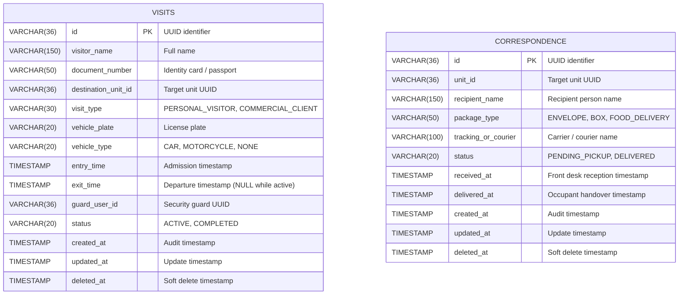

# Data Model — Access Control Service (`access_control_db`)

> Dedicated database schema for `resi-complex-access-control-service`.  
> Engine: **MySQL 8.0+** | Charset: `utf8mb4` | Collation: `utf8mb4_unicode_ci`  
> Schema evolution managed strictly via **Flyway** migrations (`V1__init_access.sql`).

---

## 1. Entity-Relationship Diagram



---

## 2. Table Specifications

### Table: `visits`

**Purpose:** Logs all individual admissions to the complex, tying the visitor to their destination unit and optional vehicle.

```sql
CREATE TABLE visits (
    id                  VARCHAR(36)  PRIMARY KEY,
    visitor_name        VARCHAR(150) NOT NULL,
    document_number     VARCHAR(50)  NOT NULL,
    destination_unit_id VARCHAR(36)  NOT NULL,
    visit_type          VARCHAR(30)  NOT NULL, -- 'PERSONAL_VISITOR' or 'COMMERCIAL_CLIENT'
    vehicle_plate       VARCHAR(20)  NULL,
    vehicle_type        VARCHAR(20)  NULL,     -- 'CAR', 'MOTORCYCLE', 'NONE'
    entry_time          TIMESTAMP    NOT NULL DEFAULT CURRENT_TIMESTAMP,
    exit_time           TIMESTAMP    NULL,
    guard_user_id       VARCHAR(36)  NULL,
    status              VARCHAR(20)  NOT NULL DEFAULT 'ACTIVE', -- 'ACTIVE', 'COMPLETED'
    created_at          TIMESTAMP    NOT NULL DEFAULT CURRENT_TIMESTAMP,
    updated_at          TIMESTAMP    NOT NULL DEFAULT CURRENT_TIMESTAMP ON UPDATE CURRENT_TIMESTAMP,
    deleted_at          TIMESTAMP    NULL
);

CREATE INDEX idx_visits_status ON visits (status);
CREATE INDEX idx_visits_unit ON visits (destination_unit_id);
CREATE INDEX idx_visits_plate ON visits (vehicle_plate);
```

### Table: `correspondence`

**Purpose:** Tracks mail, envelopes, parcels, and deliveries received at the guard booth until handed over to the resident.

```sql
CREATE TABLE correspondence (
    id                  VARCHAR(36)  PRIMARY KEY,
    unit_id             VARCHAR(36)  NOT NULL,
    recipient_name      VARCHAR(150) NOT NULL,
    package_type        VARCHAR(50)  NOT NULL, -- 'ENVELOPE', 'BOX', 'FOOD_DELIVERY'
    tracking_or_courier VARCHAR(100) NULL,     -- e.g. Servientrega, Envia, Rappi
    status              VARCHAR(20)  NOT NULL DEFAULT 'PENDING_PICKUP', -- 'PENDING_PICKUP', 'DELIVERED'
    received_at         TIMESTAMP    NOT NULL DEFAULT CURRENT_TIMESTAMP,
    delivered_at        TIMESTAMP    NULL,
    created_at          TIMESTAMP    NOT NULL DEFAULT CURRENT_TIMESTAMP,
    updated_at          TIMESTAMP    NOT NULL DEFAULT CURRENT_TIMESTAMP ON UPDATE CURRENT_TIMESTAMP,
    deleted_at          TIMESTAMP    NULL
);

CREATE INDEX idx_corr_status ON correspondence (status);
CREATE INDEX idx_corr_unit ON correspondence (unit_id);
```

---

## 3. Data Dictionary

| Table | Column | Type | Nullable | Description |
|-------|--------|------|:--------:|-------------|
| `visits` | `visit_type` | `VARCHAR(30)` | No | Distinguishes personal visitors (`PERSONAL_VISITOR`) from shoppers/diners (`COMMERCIAL_CLIENT`). |
| `visits` | `status` | `VARCHAR(20)` | No | `ACTIVE` while inside the complex; `COMPLETED` once exit is timestamped. |
| `visits` | `exit_time` | `TIMESTAMP` | Yes | Recorded when the guard clicks "Registrar Salida". |
| `correspondence` | `package_type` | `VARCHAR(50)` | No | Category of package (`ENVELOPE`, `BOX`, `FOOD_DELIVERY`). |
| `correspondence` | `status` | `VARCHAR(20)` | No | `PENDING_PICKUP` until resident claims it, then `DELIVERED`. |

---

## 4. Modeling Decisions

1. **State Machine Integrity:** A visit cannot be marked `COMPLETED` without setting `exit_time`. A package cannot transition to `DELIVERED` without setting `delivered_at`.
2. **Compound Indexing for Fast Portería Search:** Indexing `status` and `destination_unit_id` ensures instantaneous UI responses when guards search by apartment or plate on touch screens.
3. **Database per Service:** No foreign key constraints tie `visits` or `correspondence` to `units_db` directly; integration is logical by UUID.
