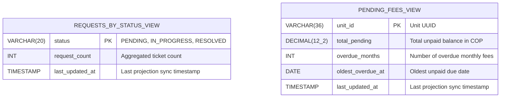

# Data Model — Reports Service (`reports_db`)

> Dedicated CQRS read-projection schema for `resi-complex-reports-service`.  
> Engine: **MySQL 8.0+** | Charset: `utf8mb4` | Collation: `utf8mb4_unicode_ci`  
> Schema evolution managed strictly via **Flyway** migrations (`V1__init_reports.sql`).

---

## 1. Entity-Relationship Diagram



---

## 2. Table Specifications

### Table: `requests_by_status_view`

**Purpose:** Pre-aggregated read projection of maintenance request counts per status (`FR19`).

```sql
CREATE TABLE requests_by_status_view (
    status VARCHAR(20) PRIMARY KEY,
    request_count INT NOT NULL DEFAULT 0,
    last_updated_at TIMESTAMP NOT NULL DEFAULT CURRENT_TIMESTAMP ON UPDATE CURRENT_TIMESTAMP
);
```

### Table: `pending_fees_view`

**Purpose:** Pre-aggregated read projection of pending administration fee balances and overdue months per unit (`FR19`).

```sql
CREATE TABLE pending_fees_view (
    unit_id VARCHAR(36) PRIMARY KEY,
    total_pending DECIMAL(12,2) NOT NULL DEFAULT 0.00,
    overdue_months INT NOT NULL DEFAULT 0,
    oldest_overdue_at DATE NULL,
    last_updated_at TIMESTAMP NOT NULL DEFAULT CURRENT_TIMESTAMP ON UPDATE CURRENT_TIMESTAMP
);
```

---

## 3. Data Dictionary

| Table | Column | Type | Nullable | Description |
|-------|--------|------|:--------:|-------------|
| `requests_by_status_view` | `status` | `VARCHAR(20)` | No | Maintenance status key (`PENDING`, `IN_PROGRESS`, `RESOLVED`) |
| `requests_by_status_view` | `request_count` | `INT` | No | Total requests currently in that status |
| `pending_fees_view` | `unit_id` | `VARCHAR(36)` | No | Logical reference to `units.id` |
| `pending_fees_view` | `total_pending` | `DECIMAL(12,2)` | No | Accumulated unpaid fee balance in COP |
| `pending_fees_view` | `overdue_months` | `INT` | No | Count of overdue billing periods (`> 2` triggers critical arrears alert) |
| `pending_fees_view` | `oldest_overdue_at` | `DATE` | Yes | Due date of the earliest unpaid fee |

---

## 4. Modeling Decisions

1. **Denormalized CQRS Read Views:** Tables are intentionally denormalized (`O(1)` primary key lookups per status or unit) so dashboard queries never scan historical transactional tables.
2. **Baseline Status Seed:** `V1__init_reports.sql` seeds `PENDING`, `IN_PROGRESS`, and `RESOLVED` with `0` so dashboard charts always render all status buckets from day one.
