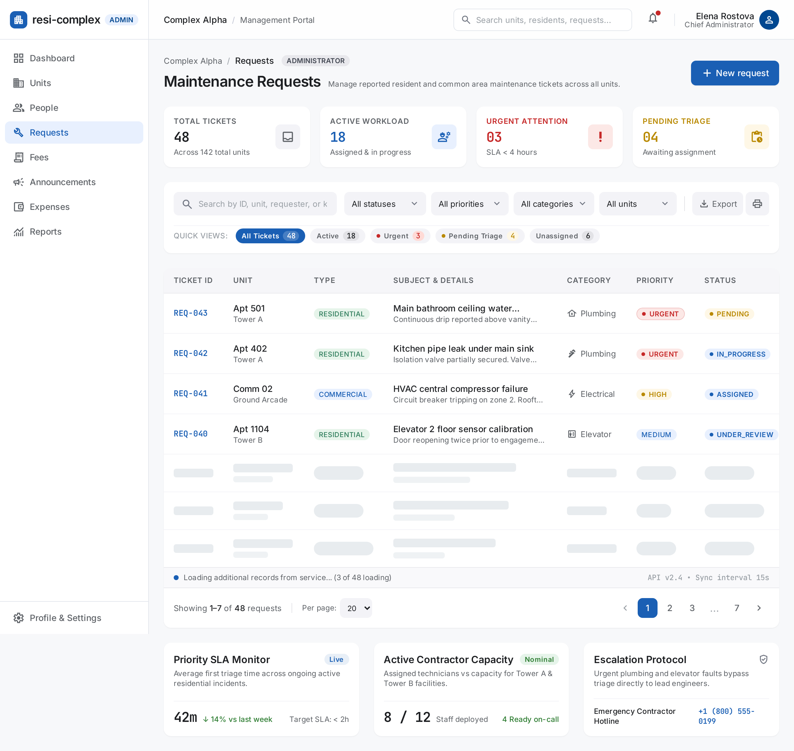
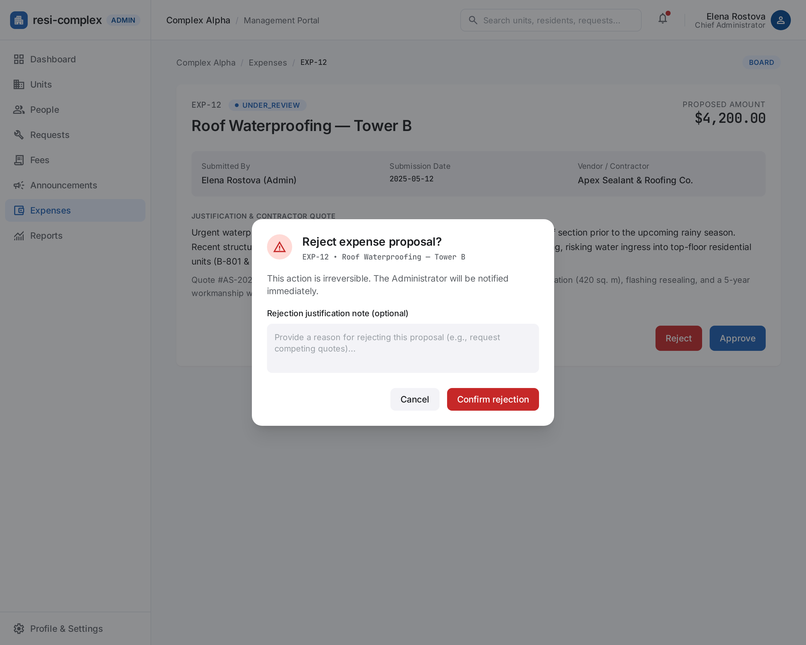
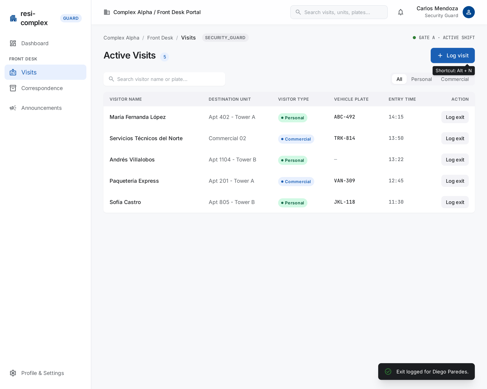

# Wireframes & High-Fidelity Mockups (Google Stitch) — resi-complex

> **Official Google Stitch Source:** [Stitch Project `15727882496787728254`](https://stitch.google.com/projects/15727882496787728254)  
> **Language Policy:** Documentation written in English per `ADR-001`; rendered screens intentionally display Colombian Spanish end-user copy to match pilot residential complex usability (`NFR-009`).
>
> This document consolidates the high-fidelity mockups and mandatory UI Kit exported from **Google Stitch** for `resi-complex`, aligned 1:1 with [`design-system.md`](./design-system.md) and [`navigation-map.md`](./navigation-map.md). Interactive HTML exports and high-resolution PNG screenshots are versioned under [`stitch/`](./stitch/).

---

## Exported Google Stitch Screen Inventory

| # | Screen / Artifact | Route (`navigation-map.md`) | Primary Role(s) | Related FR / HU | Key Design System Components | HTML Export | PNG Capture |
|---|---|---|---|---|---|---|---|
| 01 | **Mandatory Component UI Kit** | Global Design System | All 5 roles | `NFR-009` | `Badge` (Status, Priority, Unit Type), `Toast`, `Modal`, `Tooltip`, `Skeleton loader` | [`01-ui-kit-componentes.html`](./stitch/screens/01-ui-kit-componentes.html) | [`01-ui-kit-componentes.png`](./stitch/screenshots/01-ui-kit-componentes.png) |
| 02 | **Administrator Dashboard** | `/dashboard` | `ADMINISTRATOR` | `FR19`, `HU-REP-001` | KPI Cards (`reports-service`), `Tooltip`, Data Table, `Badge`, `Toast` | [`02-dashboard-administrador.html`](./stitch/screens/02-dashboard-administrador.html) | [`02-dashboard-administrador.png`](./stitch/screenshots/02-dashboard-administrador.png) |
| 03 | **Maintenance Requests List + Skeleton** | `/requests` | `ADMINISTRATOR`, `MAINTENANCE_STAFF`, `PERSON` | `FR05`, `FR06`, `HU-MAINT-001`–`002` | Search/Filters, Data Table, `Badge`, `Skeleton loader`, Pagination | [`03-lista-solicitudes.html`](./stitch/screens/03-lista-solicitudes.html) | [`03-lista-solicitudes.png`](./stitch/screenshots/03-lista-solicitudes.png) |
| 04 | **Extraordinary Expense Approval (Modal)** | `/expenses/:proposalId` (`/expenses/EXP-12`) | `BOARD` | `FR17`, `FR18`, `HU-FIN-002` | Detail Card, `Badge`, Destructive Confirmation `Modal` | [`04-aprobacion-gasto-extraordinario.html`](./stitch/screens/04-aprobacion-gasto-extraordinario.html) | [`04-aprobacion-gasto-extraordinario.png`](./stitch/screenshots/04-aprobacion-gasto-extraordinario.png) |
| 05 | **Front Desk: Visitor Registration** | `/front-desk/visits` | `SECURITY_GUARD` | `FR12`–`FR14`, `HU-ACC-001`–`003` | Simplified Sidebar, Data Table, Shortcut `Tooltip` (`Alt+N`), `Toast`, `Badge` | [`05-porteria-registro-visitas.html`](./stitch/screens/05-porteria-registro-visitas.html) | [`05-porteria-registro-visitas.png`](./stitch/screenshots/05-porteria-registro-visitas.png) |

---

## 01. UI Kit — Mandatory Components

*Visual specification of the 5 mandatory components defined in `design-system.md`: `Badge` (Status, Priority, Unit Type), `Toast`, `Modal`, `Tooltip`, and `Skeleton loader`.*

- **Interactive HTML:** [`stitch/screens/01-ui-kit-componentes.html`](./stitch/screens/01-ui-kit-componentes.html)
- **Export Resolution:** `2560 × 4200` (Desktop)

---

## 02. Administrator Dashboard (`/dashboard`)

*Primary overview for `ADMINISTRATOR` featuring 4 executive KPI cards fed by `reports-service` (`:8089`), contextual `Tooltip`, recent maintenance table with priority/status `Badge` pills, and confirmation `Toast`.*

- **Interactive HTML:** [`stitch/screens/02-dashboard-administrador.html`](./stitch/screens/02-dashboard-administrador.html)
- **Export Resolution:** `2560 × 2048` (Desktop)

---

## 03. Maintenance Requests List (`/requests`) with Skeleton Loader

*Maintenance request management view (`maintenance-service` `:8086`) with search bar, status/priority filters, active rows displaying Unit Type, Priority, and Status badges, and progressive loading via `Skeleton loader`.*

- **Interactive HTML:** [`stitch/screens/03-lista-solicitudes.html`](./stitch/screens/03-lista-solicitudes.html)
- **Export Resolution:** `2560 × 2426` (Desktop)

---

## 04. Extraordinary Expense Approval (`/expenses/EXP-12`) with Confirmation Modal

*Board of Trustees (`BOARD`) proposal review screen (`finance-approval-service` `:8088`) showing proposal justification, quorum state, and destructive confirmation `Modal` guarding irreversible votes (`BR-15`).*

- **Interactive HTML:** [`stitch/screens/04-aprobacion-gasto-extraordinario.html`](./stitch/screens/04-aprobacion-gasto-extraordinario.html)
- **Export Resolution:** `2560 × 2048` (Desktop)

---

## 05. Front Desk: Visitor Registration (`/front-desk/visits`)

*Streamlined `SECURITY_GUARD` interface (`access-control-service` `:8087`) with reduced sidebar navigation, active visitor table, keyboard shortcut `Tooltip` (`Alt + N`), and departure confirmation `Toast`.*

- **Interactive HTML:** [`stitch/screens/05-porteria-registro-visitas.html`](./stitch/screens/05-porteria-registro-visitas.html)
- **Export Resolution:** `2560 × 2048` (Desktop)

---

## Remaining MVP Screen Blueprints (Pattern Reuse)

All remaining screens listed in [`navigation-map.md`](./navigation-map.md) reuse the exact tokens and layout patterns established in Stitch screens `01`–`05`:
- **Auth & Profile (`/login`, `/activate`, `/profile`, `/admin/users`):** Centered institutional card + form validation pattern (`design-system.md` §Forms), connected to `iam-service` (`:8081`).
- **Units & People (`/units*`, `/people*`):** Standard Data Table + Create/Edit Form + Destructive `Modal` pattern (Screen `#03` + `#04`), connected to `units-service` (`:8083`) and `people-service` (`:8085`).
- **Fees & Reports (`/fees*`, `/reports`):** KPI Summary Cards + Segmented Badge Table (Screen `#02` + `#03`), connected to `billing-service` (`:8084`) and `reports-service` (`:8089`).
- **Announcements & Correspondence (`/announcements*`, `/correspondence`, `/preauthorizations`):** Filterable Card/Table Feed + 4-digit PIN handover modal, connected to `communications-service` (`:8082`) and `access-control-service` (`:8087`).

---

## Generation Prompts & Visual Governance

Exact prompts used to generate and preserve visual token fidelity in Google Stitch are maintained in [`stitch/stitch-mockup-prompts.md`](./stitch/stitch-mockup-prompts.md).
