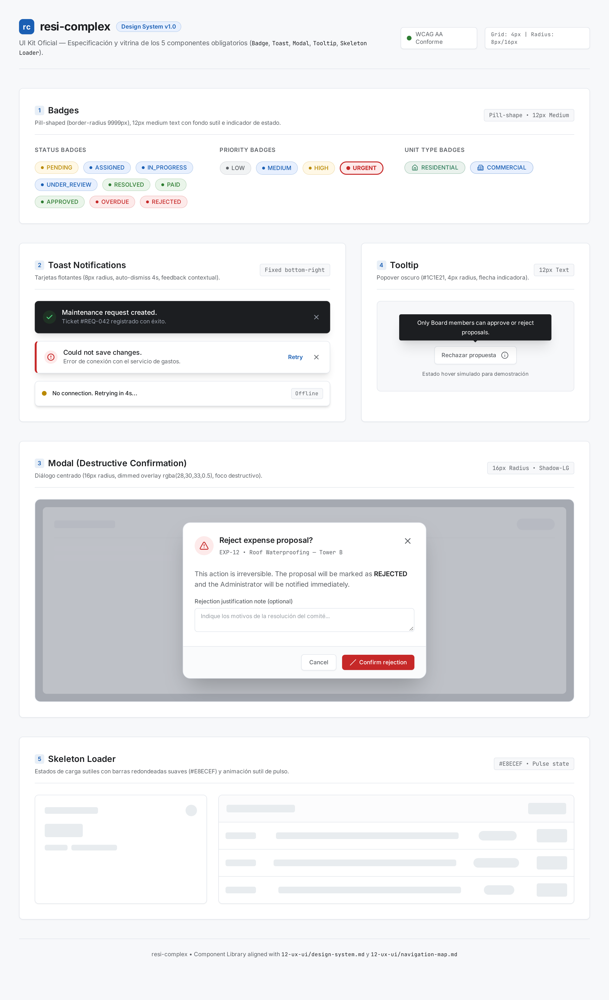
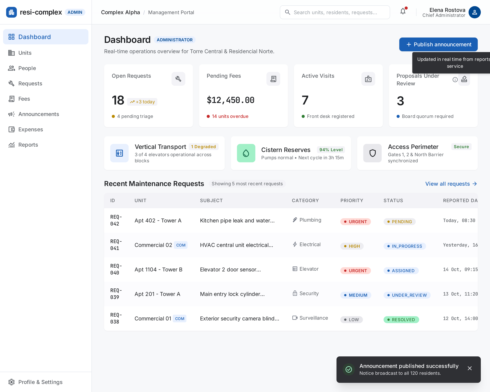

# Wireframes & High-Fidelity Mockups (Google Stitch) — resi-complex

> **Fuente oficial en Google Stitch:** [Proyecto Stitch `15727882496787728254`](https://stitch.google.com/projects/15727882496787728254)
>
> Este documento consolida las pantallas y componentes visuales implementados en **Google Stitch** para **resi-complex**, alineados con [`design-system.md`](./design-system.md) y [`navigation-map.md`](./navigation-map.md). Todos los archivos HTML interactivos y capturas PNG de alta resolución están respaldados en [`stitch/`](./stitch/).

---

## Inventario de pantallas exportadas desde Stitch

| # | Pantalla / Artefacto | Ruta (`navigation-map.md`) | Rol principal | Componentes clave | Código HTML | Captura PNG |
|---|---|---|---|---|---|---|
| 01 | **UI Kit — Componentes Obligatorios** | Sistema de diseño global | Todos | `Badge` (Status, Priority, Unit Type), `Toast`, `Modal`, `Tooltip`, `Skeleton loader` | [`01-ui-kit-componentes.html`](./stitch/screens/01-ui-kit-componentes.html) | [`01-ui-kit-componentes.png`](./stitch/screenshots/01-ui-kit-componentes.png) |
| 02 | **Dashboard del Administrador** | `/dashboard` | `ADMINISTRATOR` | KPI Cards, `Tooltip`, Data Table, `Badge`, `Toast` | [`02-dashboard-administrador.html`](./stitch/screens/02-dashboard-administrador.html) | [`02-dashboard-administrador.png`](./stitch/screenshots/02-dashboard-administrador.png) |
| 03 | **Lista de Solicitudes + Skeleton Loader** | `/requests` | `ADMINISTRATOR`, `MAINTENANCE_STAFF`, `PERSON` | Filtros, Data Table, `Badge`, `Skeleton loader`, Paginación | [`03-lista-solicitudes.html`](./stitch/screens/03-lista-solicitudes.html) | [`03-lista-solicitudes.png`](./stitch/screenshots/03-lista-solicitudes.png) |
| 04 | **Aprobación de Gasto Extraordinario (con Modal)** | `/expenses/:proposalId` (`/expenses/EXP-12`) | `BOARD` | Detail Card, `Badge`, Destructive Confirmation `Modal` | [`04-aprobacion-gasto-extraordinario.html`](./stitch/screens/04-aprobacion-gasto-extraordinario.html) | [`04-aprobacion-gasto-extraordinario.png`](./stitch/screenshots/04-aprobacion-gasto-extraordinario.png) |
| 05 | **Portería: Registro de Visitas** | `/front-desk/visits` | `SECURITY_GUARD` | Sidebar simplificado, Data Table, `Tooltip` (atajo teclado), `Toast`, `Badge` | [`05-porteria-registro-visitas.html`](./stitch/screens/05-porteria-registro-visitas.html) | [`05-porteria-registro-visitas.png`](./stitch/screenshots/05-porteria-registro-visitas.png) |

---

## 01. UI Kit — Componentes Obligatorios

*Referencia visual de los 5 componentes obligatorios definidos en `design-system.md`: `Badge` (Status, Priority, Unit Type), `Toast`, `Modal`, `Tooltip` y `Skeleton loader`.*

- **Código HTML:** [`stitch/screens/01-ui-kit-componentes.html`](./stitch/screens/01-ui-kit-componentes.html)
- **Resolución:** `2560 × 4200` (Desktop)

---

## 02. Dashboard del Administrador (`/dashboard`)

*Vista principal para el rol `ADMINISTRATOR` con 4 tarjetas KPI conectadas a `reports-service`, `Tooltip` informativo, tabla de solicitudes recientes con `Badge` de prioridad/estado y notificación `Toast`.*

- **Código HTML:** [`stitch/screens/02-dashboard-administrador.html`](./stitch/screens/02-dashboard-administrador.html)
- **Resolución:** `2560 × 2048` (Desktop)

---

## 03. Lista de Solicitudes (`/requests`) con Skeleton Loader

*Gestión de solicitudes de mantenimiento con barra de búsqueda, filtros por estado/prioridad, filas activas con `Badge` (Unit Type, Priority, Status) y estado de carga progresiva mediante `Skeleton loader`.*

- **Código HTML:** [`stitch/screens/03-lista-solicitudes.html`](./stitch/screens/03-lista-solicitudes.html)
- **Resolución:** `2560 × 2426` (Desktop)

---

## 04. Aprobación de Gasto Extraordinario (`/expenses/EXP-12`) con Modal

*Detalle de propuesta de gasto extraordinario para el rol `BOARD` (`UNDER_REVIEW`) con diálogo `Modal` de confirmación destructiva para rechazo irreversible.*

- **Código HTML:** [`stitch/screens/04-aprobacion-gasto-extraordinario.html`](./stitch/screens/04-aprobacion-gasto-extraordinario.html)
- **Resolución:** `2560 × 2048` (Desktop)

---

## 05. Portería: Registro de Visitas (`/front-desk/visits`)

*Interfaz optimizada para el rol `SECURITY_GUARD` con barra lateral reducida, tabla de visitas activas, `Tooltip` con atajo de teclado (`Alt + N`) y `Toast` de confirmación de salida.*

- **Código HTML:** [`stitch/screens/05-porteria-registro-visitas.html`](./stitch/screens/05-porteria-registro-visitas.html)
- **Resolución:** `2560 × 2048` (Desktop)

---

## Prompts y guía de generación

Los prompts exactos utilizados para generar y mantener consistencia visual en Google Stitch se encuentran en [`stitch/stitch-mockup-prompts.md`](./stitch/stitch-mockup-prompts.md).
